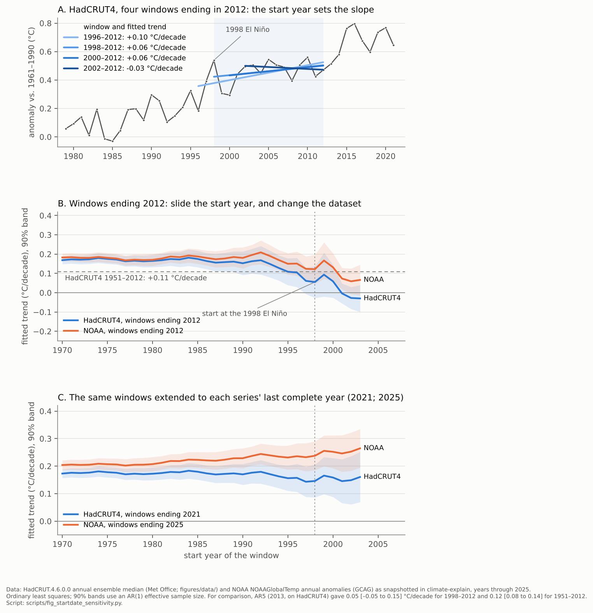

# Case study 02 — paired analyses: the "pause", the "hiatus", the slowdown

**Status:** v0.2, 2026-10-07. v0.1 (four pairs, written unattended) quoted several primaries through secondaries; v0.2 works from the primaries Steve supplied for Carter 2006, Koonin 2014, Monckton 2017 and Monbiot 2010 (quoting Rose 2010), and adds what they contain — notably that the sceptical side's bodies are hedged where its headlines are not, that the "your window too" objection was in the sceptical repertoire from 2006, and the full set of master frames in Monckton 2017. The AR5 sentences, Rose's 2012 headline and Muller's op-ed are still quoted through secondaries (`corpus.md` marks which). A draft to be checked, not a source.

**Why this case.** Case 01 ended on the hinge: both sides computed a trend over a window of their own choosing and read a significance test as the verdict. The pause dispute is that move run for a decade, and it is also the clearest instance in climate discourse of a *frame concession* — the mainstream adopting the other side's noun and then arguing about whether it should have. The case's substance is settled (`climate-science-evolution/02-problems/P08`, `RESOLVED` 2015–17), which makes it a clean test of what the framing analysis adds when the facts are no longer in dispute.

**Conventions** as in case 01: Mode A is FrameNet 1.7 annotation (frames in `Code_style`, `(gap)` for words FrameNet lacks); Mode B is the wider toolkit; substance is kept in its own section; each pair ends with two second looks. Statement IDs refer to `corpus.md`.

---

## Pair Q1 — Naming the thing: "stopped" and "the Pause" vs. "hiatus", "slowdown", "fluctuation"

### The names in play

| Name | Who used it (corpus) | FrameNet frame evoked | What the name presupposes or entails |
|---|---|---|---|
| **stopped** ("it stopped in 1998"; "stopped 16 years ago") | Carter 2006 (S-1); Rose 2012 (S-2); quoted as the slogan by Foster (M-1) and NOAA (M-13) | `Process_stop` (Process = global warming); FrameNet's chain: `Process_continue → Process_stop → Process_stopped_state` | The process ended. No resumption is built in. The date names the start of the window (the 1998 El Niño) as the moment of ending. |
| **no global warming at all** | Monckton (S-6, S-7) | negated `Change_of_temperature`; "at all" = end-of-scale `Degree` | A zero, stated as total. A fitted trend of about zero with an uncertainty range becomes "none". |
| **the Pause** (capitalized, with the definite article; "the Inconvenient Pause"; "the Pause lengthens"; "sets a new record") | Monckton (S-6, S-8) | `Activity_pause` (core FEs **Agent**, Activity) + proper name; `Expansion` ("lengthens"); `Records` ("record") | A named object in the world that grows. The frame presupposes activity before it and, by FrameNet's own scenario (`Activity_pause → Activity_paused_state → Activity_resume`), activity after; the scoreboard suppresses the resumption by making the object ever longer. The Agent slot invites "who or what paused it?" |
| **flat** / **almost steady** / **remained pretty much the same** / **the trend stays flat** | Homewood (S-3); Scafetta (S-9); Muller (M-7); Rose 2010 (S-2b) | flat **(gap)**; steady → `Precariousness` (negated); remain → `State_continue` | A line shape (a plateau: `Natural_features`) or a state that continues. Says nothing about before or after. Rose's "the trend stays flat" makes the flat line itself the trend. |
| **did not increase** … **a slight decrease, though not at a rate that differs significantly from zero** / **temperature stasis** / **a period of stasis** | Carter 2006 (S-1), body text under the headline "it stopped in 1998" | negated `Change_position_on_a_scale`; stasis **(gap)** (Greek: a standing still; in medicine, a stoppage of flow) | The body is hedged where the headline is not: "not at a rate that differs significantly from zero" is a statement about a test, "stopped" is a statement about the world. "Stasis" is a learned word for "stopped" that sounds like a measurement. |
| **increased much more slowly for the past 16 years** / **this slowing in the temperature rise** | Koonin 2014 (S-5) | slow.v → `Change_event_duration` | The sceptical side's most prominent essayist uses the *mainstream* end of the scale — a rate, continuing — while drawing the sceptical inference from it (Q2). |
| **ending the Pause** / **still on the record-books** | Monckton 2017 (S-8) | `Cause_to_end` / `Process_end`; `Records` | The frame's own entailment surfaces: a pause ends, and what ends it is "the naturally-occurring el Niño"; the Pause survives only as a record of a feat. |
| **pause** (unquoted) | Met Office 2013, series title "The recent pause in global warming" (M-3); Muller, "A Pause, Not an End" (M-7) | `Activity_pause` | Mainstream adoption. Muller's title uses the frame's own contrast — pause (resumption built in) against end (`Process_stop`) — to concede the observation and deny the entailment of "stopped". |
| **'pause'** (scare-quoted) / **putative 'pause'** | Rahmstorf 2013 (M-8); Lewandowsky et al. 2016 (M-11); NOAA (M-13) | `Activity_pause` held at arm's length (compare `Being_named`, "so-called") | The name is marked as someone else's; "putative" denies existence while using the word. |
| **hiatus** | AR5 ch. 9 Box 9.2 (M-5), defined; Kosaka & Xie 2013 and Karl et al. 2015 titles (M-6); Fyfe et al. 2016 (M-10); Medhaug et al. 2017, "often termed" (M-12) | **(gap)** — no lexical unit | A gap or break in a sequence (Latin *hiatus*, an opening); the sequence continues after it. More formal and more technical-sounding than "pause", with no Agent slot. The IPCC chapter *defined* it as "the reduction in GMST trend during 1998–2012 as compared to the trend during 1951–2012" — a smaller slope, not a gap. The word and its definition point in different directions, which Medhaug et al. later name as the source of "apparently contradictory conclusions". |
| **slowdown** / **risen more slowly** / **the rate … is smaller** / **reduced rate** | AR5 SPM (M-4); Rahmstorf (M-8); Fyfe (M-10); NOAA (M-13) | slowdown **(gap)**; slow.v → `Change_event_duration`; rate → `Rate_quantification`; reduction → `Cause_change_of_position_on_a_scale` | A continuing process at a lower rate. Continuation is built in; the question becomes "why slower?", not "why stopped?". |
| **reduction in surface warming trend** | AR5 SPM §D.1 (M-4); Box 9.2 (M-5) | `Cause_change_of_position_on_a_scale` (Attribute = trend; Agent/Cause unexpressed) | A quantity (the trend) that went down, stated agentlessly; the assessment's own register. |
| **lack of surface warming** | Met Office 2013 (M-3) | `Possession` (lack.n: Owner = the surface; Possession = warming, absent) | Warming as something the surface should have and does not — the Met Office's phrase is the closest a mainstream text comes to "no warming". |
| **seemed hardly to warm** | Medhaug et al. 2017 (M-12) | `Give_impression` (Phenomenon = the surface; Characterization = hardly warming) | Appearance against reality: the surface *seemed*; the system did not. |
| **fluctuation** / **routine fluctuation** | Lewandowsky et al. 2016 (M-11); Foster 2011 (M-1) | `Change_position_on_a_scale` (Item = the rate of warming; around a trend) | A departure in either direction around a trend, of a routine kind. Nothing to explain. |

**What Mode A gave for Q1.** The names fall on a scale that FrameNet partly supplies and partly refuses. It supplies the three frames that matter most: `Process_stop` (ended; no resumption), `Activity_pause` (suspended; an Agent; resumption in the scenario chain), and `Change_position_on_a_scale` (a routine movement around a level). It refuses the two words the dispute was conducted in — *hiatus* and *slowdown* have no lexical units — which is a finding in itself: the mainstream chose names outside the everyday lexicon, one technical-sounding (*hiatus*) and one rate-based (*slowdown*), while the sceptical side used the everyday frames (*stopped*, *no warming*, *the Pause*). FrameNet also records that "pause" is an *Activity* frame (agentive) while "stop" has a *Process* frame (non-agentive) — so "global warming has paused" grammatically invites an agent that "the warming rate was smaller" does not.

### Mode B — the naming scale and the explanatory burden

**The scale.** Ordered by what each name says about before and after:

STOPPED (ended) → NO WARMING AT ALL (zero) → THE PAUSE (suspended; will resume; a growing object) → HIATUS (a gap in a continuing sequence) → SLOWDOWN / REDUCED RATE (continuing, slower) → FLUCTUATION (routine departure; nothing to explain)

Each name sets an **explanatory burden**. "Stopped" needs no account of a resumption, because there is none. "Pause" and "hiatus" presuppose a gap in an ongoing thing and so demand an explanation of the gap — "an explanatory challenge that climate science must resolve" (M-11, `Difficulty`/`Resolve_problem`). "Slowdown" demands an explanation of a rate. "Fluctuation" says the explanation is already in hand (variability around a trend). The dispute over the word is a dispute over who owes an explanation of what.

**The frame concession.** When the Met Office titled three reports "The recent pause in global warming" (M-3) and the IPCC chapter boxed "the Hiatus" (M-5), the mainstream took on the burden the words carry. Lewandowsky et al. (M-9, M-11) say this was *seepage* — the contrarian message adopted "in its problem-solving and answer-seeking role" — and propose "an alternative framing" (fluctuation). Muller (M-7) shows the other way to handle the word: keep it and disarm its strongest entailment in the title ("A Pause, Not an End"). The IPCC did a third thing: used "hiatus" and then defined it as a reduction in trend, so that the technical content was "slowdown" while the word said "gap" — which is the mismatch Medhaug et al. identify in M-12. Three mainstream strategies for one word: adopt and explain; adopt and disarm; adopt and redefine. A fourth, refuse the word, is what Rahmstorf's scare quotes and Lewandowsky's "putative" do.

**Reification and presupposition.** Monckton's capital-P "Pause" with the definite article, a length, and a record turns a description of a fitted trend into an object: it "lengthens", "sets a new record", becomes "Inconvenient". The definite article presupposes existence; the capital makes a proper name; `Expansion` and `Records` give it a body and a sport. Once it is an object, its disappearance from the data has to be an act (Q4: "airbrushed out"), since objects do not stop existing by themselves. On the other side, the scare quotes and "putative" presuppose non-existence while the sentence uses the word — the mirror move, and a listener who remembers the Met Office title will hear it as erasure.

**The date as a name.** "Stopped in 1998", "since January 1997", "16 years ago": the start of the window is part of the name, and it is the month of the largest El Niño spike in the record. The AR5 sentence (M-4) names the same fact from the other side — "which begins with a strong El Niño" — and that clause is the whole scientific answer to the name.

**The scale cuts across the sides.** The names are not partitioned by allegiance. Koonin (S-5) says "increased much more slowly" and "this slowing in the temperature rise" — the rate-based, continuing end of the scale — and draws the sceptical inference from it; the Met Office (M-3) says "the recent pause" and "lack of surface warming" — the sceptical end — and draws the mainstream inference. What is partitioned by allegiance is the *position of the strong word*: on the sceptical side it is in the headline (Carter: "it stopped in 1998"; Rose: "stopped 16 years ago"; Monckton: "no global warming at all") and the body is hedged (Carter: "not at a rate that differs significantly from zero"; Koonin: "much more slowly"); on the mainstream side the strong word is in the press register (case 01: "groundless misconception", "proving") and the hedge is in the chapter ("medium confidence"). Case 01's finding — both sides hedge where readers do not look — holds here with the sides' positions on the scale reversed between headline and body.

**Construal.** The sceptical names profile the *surface*, the *recent window*, and the *zero*; the mainstream names profile the *rate*, the *long record*, and the *system* (M-8: "even if the surface temperature stagnates our planet continues to take up heat" — the profiled entity shifts from surface to planet). Neither side marks that it has chosen a profile.

### Substance notes (not framing)

The 1998–2012 surface trend was smaller than the 1951–2012 trend (AR5: 0.05 [–0.05 to 0.15] against 0.12 [0.08 to 0.14] °C per decade); most model runs warmed faster over that window; the difference was later attributed to Pacific decadal variability, a reduced forcing trend (volcanic aerosol, solar minimum, aerosols) and observational coverage bias, and the dataset corrections of 2014–15 were tested against independent records and held; the record El Niño of 2015–16 and the years after ended the observational question (`P08`, `RESOLVED`). So: "stopped" was wrong (warming resumed, strongly); "no warming at all" overstated a trend estimate whose range included 0.15 °C per decade; "pause"/"hiatus" were defensible as descriptions of the surface series at the time and misleading in what they presupposed; "slowdown" and "reduced rate" were accurate; "routine fluctuation" was accurate about the long-term trend and understated what there was to learn about the Pacific and the oceans, which the field then learned.

### Second looks

*If a friend says:* "Global warming stopped in 1998 — even the IPCC admitted there was a pause."

> "Stopped", "paused", "slowed" and "fluctuated" are four pictures of one set of numbers, and they say different things about what comes next: "stopped" means it ended; "paused" means it's suspended and will resume — that's built into the word; "slowed" means it continued at a lower rate. The IPCC's sentence was the third: a smaller rate over fifteen years that began with a big El Niño, with a range that runs from slightly negative to 0.15 per decade. Which picture was right is now on the record — what the temperature did after 2014. Worth knowing: scientists did adopt "pause" and "hiatus" in 2013, and some of them later argued that was a mistake of naming rather than a finding.

*If I say (or a mainstream friend says):* "There never was a pause — it was a routine fluctuation that deniers turned into a slogan."

> "Never was" and "routine" are choices too. The IPCC wrote that the fifteen-year rate was smaller and that the models did not generally reproduce it; the Met Office put "the recent pause" in the titles of three reports; the field spent four years working out what the Pacific and the oceans were doing. "Fluctuation" is the frame that says nothing needs explaining — fair for the long-term trend, not for that question, which got answered. A sceptical friend who has seen the Met Office title will hear "never was" as rewriting; "a slower decade, since explained" is both truer and harder to dismiss.

---

## Pair Q2 — The inference about the models: "powerful enough to counteract" vs. "reconciles models and data"

### The statements

S side:

> Although the Earth's average surface temperature rose sharply by 0.9 degree Fahrenheit during the last quarter of the 20th century, it has increased much more slowly for the past 16 years, even as the human contribution to atmospheric carbon dioxide has risen by some 25%. This surprising fact demonstrates directly that natural influences and variability are powerful enough to counteract the present warming influence exerted by human activity. / Yet the models famously fail to capture this slowing in the temperature rise. Several dozen different explanations for this failure have been offered, with ocean variability most likely playing a major role. But the whole episode continues to highlight the limits of our modeling. (S-5, Koonin 2014)

> In a given model, dozens of such assumptions must be adjusted ("tuned," in the jargon of modelers) to reproduce both current observations and imperfectly known historical records. (S-5)

> (Curry quoting the IPCC:) Models do not generally reproduce the observed reduction in surface warming trend over the last 10–15 years. (S-4)

> (Curry:) I quickly got dizzy owing to seemingly unwarranted assumptions and incomplete information... I was then going to illustrate how any reasonable propagation of uncertainty of individual assertions/arguments through their main argument would produce much lower confidence in their overall conclusions. (S-4)

> the IPCC projection is always worst, and statistically diverges from the temperature since 2006. (S-9, Scafetta 2012)

M side:

> In summary, the observed recent warming hiatus, defined as the reduction in GMST trend during 1998–2012 as compared to the trend during 1951–2012, is attributable in roughly equal measure to a cooling contribution from internal variability and a reduced trend in external forcing (expert judgment, medium confidence). (M-5, AR5 Box 9.2)

> A central point here: even if the surface temperature stagnates our planet continues to take up heat. (M-8, Rahmstorf 2013)

> It has been claimed that the early-2000s global warming slowdown or hiatus, characterized by a reduced rate of global surface warming, has been overstated, lacks sound scientific basis, or is unsupported by observations. The evidence presented here contradicts these claims. (M-10, Fyfe et al. 2016)

> Here we show that apparently contradictory conclusions stem from different definitions of 'hiatus' and from different datasets. A combination of changes in forcing, uptake of heat by the oceans, natural variability and incomplete observational coverage reconciles models and data. Combined with stronger recent warming trends in newer datasets, we are now more confident than ever that human influence is dominant in long-term warming. (M-12, Medhaug et al. 2017)

> (Trenberth, quoted by Monbiot:) One should not be misled by seizing on an individual value or year and citing trends for that, because natural variability such as from El Niño creates ups and downs all the time. / (Monbiot:) Does Rose expect warming to proceed along a straight line? (M-14, 2010)

### Mode A — FrameNet-literal annotation

| Side | Span | Target | FrameNet frame | Frame elements | Note |
|---|---|---|---|---|---|
| S | it has INCREASED much more SLOWLY for the past 16 years, even as the human contribution to atmospheric carbon dioxide has RISEN by some 25% | increase; slowly; rise | `Change_position_on_a_scale`; `Taking_time`; `Change_position_on_a_scale` | Item = surface temperature; Item = the human contribution | Koonin's own name for the episode is a rate, not a stop; the "even as" sets up the tug-of-war. |
| S | This SURPRISING fact DEMONSTRATES directly that natural influences and variability are POWERFUL enough to COUNTERACT the present warming INFLUENCE exerted by human activity | surprising.a; demonstrate.v; powerful.a; counteract; influence.n | `Stimulus_focus`; `Evidence`; `Level_of_force_exertion`; —; `Objective_influence` | Stimulus = the fact; Support = the slowdown; Proposition = nature can counteract; Exerter = natural influences; Force = powerful; Influencing_entity = human activity | counteract **(gap)**, but the sentence is force-dynamic through and through: two forces, the natural one strong enough to hold the human one. "Surprising" presupposes an expectation that was violated — whose expectation is not said. The concession is explicit — a "warming influence exerted by human activity". |
| S | Several dozen different EXPLANATIONS for this FAILURE have been OFFERED, with ocean variability most likely playing a major role. But the whole EPISODE continues to HIGHLIGHT the LIMITS of our modeling. | explanation.n; failure.n; offer.v; episode.n; highlight; limit.n | `Explaining_the_facts`; `Success_or_failure`; `Offering`; `Event`; — **(gap)**; `Limitation` | Fact = the failure; Agent = the models; Offerer = (unnamed); Theme = explanations; Entity = our modeling | The number of explanations is offered as evidence against them (ad hoc rescue); the concession ("ocean variability … a major role") is in the same sentence. |
| S | dozens of such assumptions must be ADJUSTED ("TUNED," in the jargon of modelers) to REPRODUCE both current observations and imperfectly known historical records | adjust.v; tune; reproduce.v | `Adjusting`; (musical-instrument image); `Duplication` | Agent = modelers; Part = assumptions; Creator = model; Original = observations and records | Case 01 P1's "calibration vs. fitting" in a third word: "tuned", scare-quoted and attributed to the modelers' "jargon". |
| S | the models famously FAIL to CAPTURE this slowing | fail.v; capture.v | `Success_or_failure`; `Taking_captive` / `Conquering` (lexical base) | Agent = the models; Captive = the slowing (escaped) | The modelling sense is a **(gap)**; the base image is a quarry that got away. "famously" presupposes common knowledge. |
| S | Models do not generally REPRODUCE the observed REDUCTION in surface warming trend | reproduce.v; reduction.n | `Duplication`; `Cause_change_of_position_on_a_scale` | Creator = models; Original = the observed reduction; Copy = (absent) | The IPCC's own verb: models as copyists of nature. A concession in the report's words. |
| S | I quickly got DIZZY owing to seemingly unwarranted ASSUMPTIONS … any reasonable PROPAGATION of UNCERTAINTY … would produce much lower CONFIDENCE | dizzy; assumption; propagation; uncertainty; confidence | — ; — ; — ; `Certainty` (uncertainty, confidence) | Cognizer = Curry (dizzy) / the IPCC (confidence) | dizzy, assumption, propagation **(gap)**. "Got dizzy" following the IPCC's "logic": REASONING IS A PATH, and this one makes the walker dizzy. Uncertainty as a fluid that propagates through an argument and should lower a quantity (confidence). |
| S | the IPCC projection … statistically DIVERGES from the temperature since 2006 | diverge | — | — | **(gap)**; two paths parting (case 01, P4). |
| M | the observed recent warming HIATUS, DEFINED as the REDUCTION in GMST trend … is ATTRIBUTABLE in roughly equal MEASURE to a cooling CONTRIBUTION from internal variability and a reduced trend in external forcing (expert JUDGMENT, medium CONFIDENCE) | hiatus; define.v; reduction.n; attributable; contribution.n; judgment.n; confidence | —; `Communicate_categorization`; `Cause_change_of_position_on_a_scale`; —; `Giving`; `Legal_rulings` (only sense); `Certainty` | Speaker = the authors; Item = the hiatus; Category = a reduction in trend; Donor = internal variability / reduced forcing; Theme = a cooling contribution; Cognizer = the authors (medium confidence) | hiatus, attributable **(gap)**. FrameNet's only frame for "judgment" is a court's ruling — the lexical base of "expert judgment" is a verdict. The PARTITION frame of case 01 P5 ("roughly equal measure"), hedged twice by the calibrated-language apparatus. |
| M | even if the surface temperature STAGNATES our planet CONTINUES to TAKE UP HEAT | stagnate.v; continue.v; take up.v | `Progression` (stalled); `Process_continue`; `Activity_start` (the lexicon's only sense; the physical "absorb" sense is a **gap**) | Entity = the surface temperature (no progress); Process = heat uptake; Agent = the planet | The profiled entity changes mid-sentence: surface → planet. "Stagnates" concedes the surface; `Process_continue` claims the system. |
| M | It has been CLAIMED that the early-2000s global warming SLOWDOWN or HIATUS … has been OVERSTATED, LACKS sound scientific BASIS, or is UNSUPPORTED by observations. The EVIDENCE presented here CONTRADICTS these claims. | claim.v; slowdown; hiatus; overstate; lack.v; basis; evidence.n; contradict.v | `Statement`; —; —; —; `Possession`; —; `Evidence`; `Evidence` | Speaker = (other mainstream scientists); Support = the evidence here; Proposition = the slowdown is real (contradict.v: Support = the evidence; Proposition = these claims, negated) | A mainstream paper rebutting mainstream colleagues in the same frames (`Statement`, `Evidence`) the sides use on each other. |
| M | apparently CONTRADICTORY conclusions STEM from different DEFINITIONS of 'hiatus' and from different datasets | contradictory; stem from; definition | —; (`Causation`, PLANT image); — | Cause = definitions and datasets; Effect = contradictory conclusions | The paper locates the dispute in the *word's* definition — a framing finding inside a physics paper. |
| M | A combination of … RECONCILES models and data | reconcile.v | — | — | **(gap)**; the image is of two estranged parties brought back together — models and data as persons who quarrelled. |
| M | we are now MORE CONFIDENT than ever that human influence is DOMINANT in long-term warming | confident.a; dominant.a | `Certainty`; `Dominate_situation` (or `Dominate_competitor`) | Cognizer = we; Content = human influence dominant; Degree = more than ever; Agent = human influence; Situation = long-term warming | The pair's one `Certainty` statement with an intensifier, placed right after a decade the models did not reproduce. `Dominate_competitor` is also listed — the tug-of-war reading is available to the mainstream sentence too. |
| M | One should not be MISLED by SEIZING on an individual value or year and citing trends for that, because natural variability such as from El Niño creates UPS AND DOWNS all the time | mislead.v; seize.v; ups and downs | `Prevarication` / `Intentional_deception`; `Taking`; `Change_position_on_a_scale` | Victim = one; Agent = (the reader who seizes); Theme = a value or year | The deception verb is used reflexively — one misleads oneself by seizing; "ups and downs" is the fluctuation frame in plain words. |
| M | Does Rose EXPECT warming to PROCEED along a STRAIGHT LINE? | expect.v; proceed.v; straight line | `Expectation`; `Process_continue` / `Progression`; (PATH image) | Cognizer = Rose; Phenomenon = linear warming | The question names the hidden premise of "flat for 15 years": that the trend should show in every window. |

**What Mode A gave for Q2.** The sceptical inference is force-dynamic — `Level_of_force_exertion`, "counteract", a quarry that "escaped capture" — and it rests on `Evidence` ("demonstrates directly"). The mainstream reply is a partition hedged by `Certainty` language ("expert judgment, medium confidence") and a change of profiled entity (surface → planet), and it ends on `Certainty` intensified ("more confident than ever"). Both sides concede in their own words what the other side presses: Koonin's sentence contains "the present warming influence exerted by human activity"; the IPCC's contains "models do not generally reproduce". The gaps are again the technical words (reproduce in the modelling sense, counteract, attributable, reconcile, diverge, hiatus), and two of them carry images the lexicon does record elsewhere: capture (a captive) and reconcile (a quarrel).

### Mode B — frames, metaphors, construal, scenario

**S: THE TUG-OF-WAR.** "Natural influences and variability are powerful enough to counteract the present warming influence exerted by human activity": two forces on a rope, the natural one pulling harder for sixteen years. Entailments pressed: if nature can hold the human push for sixteen years, the human push is weaker than the models say, and the models "fail" (`Success_or_failure`) because they did not foresee it. Entailments hidden: (a) a tug-of-war has one rope and two steady pulls; the system has a trend and oscillations, and a decade in which an oscillation offsets the trend says the oscillation is large, not that the trend is small — the IPCC's partition (M-5) says both pulls were present "in roughly equal measure"; (b) "fail to capture" treats the timing of internal variability as something a model should predict, when ensembles contain such decades without predicting when they fall (P08: Easterling & Wehner 2009 showed such decades are expected); (c) the sentence's own concession — a "present warming influence exerted by human activity" — is the thing the frame makes a reader forget. Koonin's full paragraph adds two moves the shortened quotation hid. "This surprising fact" (`Stimulus_focus`) presupposes an expectation that the slowdown violated — but the expectation that warming shows in every sixteen-year window is the sceptical premise, not the field's (Monbiot's question to Rose, "Does Rose expect warming to proceed along a straight line?", names it from the other side). And "several dozen different explanations … have been offered" turns the number of explanations into evidence against the models — the AD HOC RESCUE frame — in the same sentence that concedes the explanation ("ocean variability most likely playing a major role"). The multiplicity was the field working the problem from several directions (forcing, ocean uptake, the Pacific, coverage), which is also what Medhaug et al. say "reconciles" models and data: the same fact, as a defect in one frame and as a solution in the other. His "tuned" — scare-quoted, "in the jargon of modelers" — is case 01 P1's "calibration vs. fitting" contest in a third word, the musical-instrument image carrying the suggestion of a result adjusted to taste. Curry's version is epistemic rather than physical: a path of reasoning on which one "gets dizzy", uncertainties that should "propagate" into "much lower confidence" — REASONING IS A PATH and CONFIDENCE IS A QUANTITY that leaks. Its hidden entailment: that confidence in attribution is a single number fed by the surface trend alone, when the assessment's attribution rests on several independent lines (ocean heat, spatial patterns, the responses to eruptions — case 01, P1).

**M: THE PARTITION, THE SYSTEM, AND THE RECONCILIATION.** The IPCC's reply is case 01's partition frame again — contributions "in roughly equal measure" from variability and forcing — with the calibrated-language hedges that the frame does not usually carry ("expert judgment, medium confidence"). Rahmstorf's reply changes the profiled entity: "even if the surface temperature stagnates our planet continues to take up heat" — the CONTAINER/ENERGY-BUDGET frame, in which the surface is one compartment and the planet the whole, so that a surface stall is not a system stall. Medhaug et al. personify the parties — "reconciles models and data", conclusions that "stem from" definitions — and end on intensified certainty. Entailments pressed: the departure is explained, within what the models produce; the system kept warming; confidence is restored. Entailments hidden: (a) "reconciles" says the quarrel is over, but the reconciliation was assembled after the fact from forcing revisions, dataset corrections and a Pacific pattern the models did not time — a legitimate explanation, and also exactly the shape ("adjusted afterwards") that the sceptical frame of Q4 names; (b) "medium confidence" and "expert judgment" are in the chapter box, not in the press register that reached readers (case 01, P4: "groundless misconception"); (c) "more confident than ever" directly after a decade the models did not reproduce invites the charge that nothing could count against the models — the charge is answerable (a thirty-year flat period with no ocean heat uptake would have counted), but the sentence does not answer it.

**Shared frame: MODELS UNDER TEST — as copyists (`Duplication`) or as forecasters.** Both sides accept that a model is tested by whether it "reproduces" or "captures" the observed series. They differ on what counts as a failed test: a fifteen-year window starting at an El Niño (S), or a departure outside the ensemble's range over a period long enough to average variability (M). Fyfe et al. (M-10) is the useful complication: mainstream scientists insisting, against mainstream colleagues, that the slowdown was real relative to expectation — the test was failed in a specific sense (most runs warmed faster) even though the explanation held. The frame analysis does not decide this; it shows that "fail" and "reconcile" are both end-states of the same test frame, chosen by the speaker.

**Scenario / narrative.** S: nature overpowers the human influence; the experts who said otherwise are exposed; the moral is "unsettled" (Koonin's title) and a red-team remedy. M: a puzzle (`Predicament`, `Difficulty`) is solved by the field in its "problem-solving and answer-seeking role" (M-11), the pieces of the "jigsaw" (M-8's title) fit, the parties are reconciled, confidence returns. Each is a complete story with the other side's refusal already written in.

### Substance notes (not framing)

The assessment's position was stated in the chapter in 2013 with its weak point marked ("expert judgment, medium confidence"); the explanation was then built out over 2013–17 and the observational question ended with the 2015–16 El Niño (`P08`). Koonin's inference from "nature counteracted for sixteen years" to "the models fail" needs the premise that models should reproduce the timing of internal variability, which they do not claim to; his separate claim that the sensitivity range was "no different, and no more certain, than it was 30 years ago" was true of the Charney range and was overtaken by Sherwood et al. 2020 and AR6 (`08` §4). Curry's call for propagating uncertainty into lower confidence is answered, in the assessments, by the independence of the attribution lines, not by the surface trend. Fyfe et al. 2016 and Rahmstorf, Foster & Cahill 2017 disagreed on whether the underlying rate changed; Medhaug et al. 2017 is the synthesis; the newer datasets warmed faster and their corrections were tested (Hausfather et al. 2017).

### Second looks

*If a friend says:* "The pause proves natural variability can cancel out CO₂ — so the models have the human effect far too high."

> "Cancel out" is a tug-of-war picture: two pulls on one rope, the stronger wins. For about fifteen years the natural pull did win at the surface — the IPCC itself said so, "in roughly equal measure" variability and weaker forcing. The step to check is the next one: a decade-long offset says the natural pull can be big for a while; it doesn't say the human pull is small, and a model can have the human push right without predicting when the Pacific will pull the other way. Two questions: what would fifteen years look like if the models were right — their own runs contain such decades — and what happened after 2014? (Koonin's own sentence grants "the present warming influence exerted by human activity"; the disagreement is about size.)

*If I say (or a mainstream friend says):* "The hiatus is fully explained — models and data are reconciled, and we're more confident than ever."

> "Reconciled" is a quarrel-ended picture, and "fully explained" hides that the explanation is a split with "medium confidence" in the chapter, assembled afterwards from forcing revisions, dataset corrections and a Pacific pattern the models didn't time. That is a legitimate explanation; it is also exactly the shape a sceptical friend will call "adjusted after the fact", so it's better said plainly. The stronger version: the models' spread allowed such a decade; the specific causes were worked out and the data corrections were tested against independent records; the newer data warmed faster. And say what would have counted against the models — a thirty-year flat period, no ocean heat uptake — and that it didn't happen.

---

## Pair Q3 — Keeping score: "no global warming at all for 18 years 8 months" vs. "not diagnostic of long-term trends"

### The statements

S side:

> One-third of Man's entire influence on climate since the Industrial Revolution has occurred since January 1997. Yet for 224 months since then there has been no global warming at all (Fig. 1). With this month's RSS temperature record, the Pause sets a new record at 18 years 8 months. (S-6)

> The RSS satellite dataset shows no global warming at all for 220 months from December 1996 to March 2014 – more than half the 435-month satellite record (S-7, Monckton quoted)

> Satellite temperature readings show there has been no warming trend for nearly 18 and one-half years, meaning there has been no statistically significant warming since the late 1990s. (S-7, Daily Caller)

> (Homewood's fragments:) "28 years of cooling – 1951-79"; "12 years of cooling again – 2001-2013"; "40 out of 62 years"; "temperatures have been flat since 2001" (S-3)

> Consider the simple fact, drawn from the official temperature records of the Climate Research Unit at the University of East Anglia, that for the years 1998-2005 global average temperature did not increase (there was actually a slight decrease, though not at a rate that differs significantly from zero). […] In response to these facts, a global warming devotee will chuckle and say "how silly to judge climate change over such a short period". Yet in the next breath, the same person will assure you that the 28-year-long period of warming which occurred between 1970 and 1998 constitutes a dangerous (and man-made) warming. Tosh. (S-1, Carter 2006)

> They go up a bit, then down a bit, but those small rises and falls amount to less than their measuring system's acknowledged margin of error. They have no statistical significance and reveal no evidence of any trend at all. (S-2b, Rose 2010)

M side:

> Due to natural variability, trends based on short records are very sensitive to the beginning and end dates and do not in general reflect long-term climate trends. As one example, the rate of warming over the past 15 years (1998–2012; 0.05 [–0.05 to 0.15] °C per decade), which begins with a strong El Niño, is smaller than the rate calculated since 1951 (1951–2012; 0.12 [0.08 to 0.14] °C per decade). (M-4, AR5 SPM)

> […] meaningless statements about "no statistically significant warming for 15 years" (or 10 years, or 7, or since last Thursday). […] All five data sets show statistically significant warming since 2000. (M-1, Foster 2011)

> […] there is no evidence that identifies the recent period as unique or particularly unusual. […] scientists have long recognized that the climate fluctuates, that linear increases in CO2 do not produce linear trends in global warming, and that 15-yr (or shorter) periods are not diagnostic of long-term trends. (M-11)

> How much slower depends on the fine print: which global temperature dataset you look at, whether it includes the Arctic, and the exact time periods you compare. (M-13, NOAA)

> (Phil Jones, quoted by Monbiot:) The error of estimate of global averages or the forecasts for subsequent years is completely unrelated to the trend of warming. This is comparing apples with oranges. (M-14, 2010)

### Mode A — FrameNet-literal annotation

| Side | Span | Target | FrameNet frame | Frame elements | Note |
|---|---|---|---|---|---|
| S | One-third of Man's entire INFLUENCE on climate … has OCCURRED since January 1997 | influence.n; occur.v | `Objective_influence`; `Event` | Influencing_entity = Man; Time = since January 1997 | The premise: forcing rose; so a zero trend is a failed prediction. |
| S | for 224 MONTHS since then there has been NO global WARMING AT ALL | month.n; no … at all | `Measure_duration`; negated `Change_of_temperature`, Degree = at all | Count = 224; Unit = month; Process = (no warming) | Counting in months makes the number large; "at all" totalizes a trend estimate. |
| S | the Pause SETS a new RECORD at 18 years 8 months | set a record; record.n | `Records` (sport) | Record = 18 years 8 months | A sporting record implies an athlete and a feat. |
| S | the RSS satellite DATASET shows no global warming … from December 1996 … more than HALF the 435-month satellite RECORD | dataset; half.n; record.n | —; `Part_whole`; `Records`/`Text` (the archive sense) | Part = 220 months; Whole = the 435-month record | Two senses of "record" within one argument: the archive and the feat. |
| S | no STATISTICALLY SIGNIFICANT warming since the late 1990s | significant.a | `Importance` only | — | **(gap)** for the statistical sense: the lexicon has only "important", the lay reading. |
| S | "40 out of 62 years" (cooling); "flat since 2001" | — | `Part_whole`; flat **(gap)** | Part = 40 years; Whole = 62 | The record cut into cooling and warming segments to contest the comparison period. |
| S | for the years 1998-2005 global average temperature did not INCREASE (there was actually a slight DECREASE, though not at a RATE that differs SIGNIFICANTLY from zero) | increase; decrease; rate.n; significantly | `Change_position_on_a_scale`; `Change_position_on_a_scale`; `Rate_quantification`; `Importance` only | Item = global average temperature; Rate ≈ 0 | The body states the test correctly — a rate not distinguishable from zero over eight years — under a headline that says "stopped". |
| S | a global warming DEVOTEE will CHUCKLE and say "how silly to judge climate change over such a SHORT period". Yet in the next breath, the same person will ASSURE you that the 28-year-long period of warming … constitutes a DANGEROUS (and MAN-MADE) warming. TOSH. | devotee; chuckle.v; short.a; assure; dangerous; man-made; tosh | —; `Communication_noise`; `Duration_description`; (`Telling`); (`Risky_situation`); —; — | Speaker = the devotee | The window objection pre-empted in 2006 by turning it back: your 28 years is a choice too. "Devotee" puts the opponent in the religion frame (Q4). |
| S | those small rises and falls amount to less than their measuring system's acknowledged MARGIN OF ERROR. They have no statistical SIGNIFICANCE and reveal no EVIDENCE of any trend at all. | margin of error; significance; evidence.n | — ; `Importance` only; `Evidence` | Support = the rises and falls (negated); Proposition = a trend | margin **(gap)**. Measurement error and trend uncertainty are run together — the category confusion Jones names (M-14). |
| M | trends based on SHORT records are very SENSITIVE to the BEGINNING and END dates and do not in general REFLECT long-term climate trends | short.a; sensitive.a; end.n; reflect.v | `Duration_description`; — ; `Temporal_subregion`; — | Eventuality = the records; Period = short; Subpart = beginning/end; Time_period = the record | sensitive (statistical sense) and reflect ("correspond to") are **(gaps)** — FrameNet has only `Health_response` and `Cogitation`. The assessment's statement of the window dependence, in its own register. |
| M | which BEGINS with a strong El Niño | begin.v | `Activity_start` / `Process_start` | Process = the 15-year window; Time = a strong El Niño | The start date named as the explanation. |
| M | 0.05 [–0.05 to 0.15] °C per decade … 0.12 [0.08 to 0.14] | — | `Rate_quantification` with ranges | Rate; Entity = warming | The same arithmetic as the scoreboard, stated with uncertainty; the lower range includes zero and the upper 0.15. |
| M | MEANINGLESS statements about "no statistically significant warming for 15 years" (or … since last THURSDAY) | meaningless; Thursday | —; `Calendric_unit` | — | Ridicule by reduction to the absurd window; register, not substance. |
| M | statistically SIGNIFICANT warming since 2000 | significant.a | `Importance` only | — | The mirror window; the same **(gap)**. |
| M | no evidence that identifies the recent period as UNIQUE or particularly UNUSUAL | unique.a; unusual.a | `Idiosyncrasy`; `Typicality` | Entity = the recent period | The claim is about typicality: the fluctuation is ordinary. |
| M | 15-yr (or shorter) periods are not DIAGNOSTIC of long-term trends | diagnostic | — (medical image) | — | **(gap)**; a window as a diagnostic test with a false-positive rate. |
| M | depends on the FINE PRINT: which dataset …, whether it includes the Arctic, and the exact time periods you compare | fine print | — (contract image) | — | NOAA's frame: the answer is in the terms and conditions. |
| M | The ERROR of estimate of global averages … is completely UNRELATED to the trend of warming. This is comparing APPLES with ORANGES. | error; unrelated; apples with oranges | —; —; (`Evaluative_comparison`, proverb) | Profiled_item = measurement error; Standard_item = trend uncertainty | Jones's reply to Rose separates two quantities the "margin of error" frame had merged. |

**What Mode A gave for Q3.** The scoreboard is built from `Records` (the sporting feat), `Calendric_unit` (months, which make the number big), an end-of-scale `Degree` ("at all") and the `Importance` reading of "significant" — the last a lexical gap that is also the lay misreading on which the slogan works ("no significant warming" heard as "no warming worth mentioning"). The mainstream reply is in `Rate_quantification` with ranges, `Typicality`, and two frames the lexicon lacks but whose images are clear, the diagnostic test and the fine print. And the two sides share the `Importance`/significance gap exactly: "statistically significant warming since 2000" (M-1) and "no statistically significant warming since the late 1990s" (S-7) are the same test on different windows, read as verdicts.

### Mode B — frames, metaphors, construal, scenario

**S: THE RECORD-SETTING FEAT.** Monckton's monthly posts are a sporting ledger: the Pause "lengthens", "sets a new record", is measured in months (224, 225), on one named dataset (RSS), from one named start month. The frame's hidden structure is a **procedure**: find the longest window ending this month whose fitted trend is zero or less, on the dataset that gives the longest such window. On a series with a large spike inside the window, that procedure always returns something, and the number grows by one each month the spike stays inside it; the "record" is a property of the rule, not of the climate. The frame also hides that "no warming at all" is a point estimate reported without its range — the IPCC's own figure for a comparable window runs from −0.05 to +0.15 °C per decade — and that other datasets (surface; UAH; the later RSS v4) give other windows. Homewood's "40 out of 62 years" is the same construal in reverse: cut the comparison period into segments so that the long baseline looks like a trick, which is Pair 3's deception frame applied to a choice of period.

**M: THE DIAGNOSTIC TEST AND THE FINE PRINT.** The assessment states the dependence plainly — "very sensitive to the beginning and end dates", "which begins with a strong El Niño" — and gives the rates with ranges. Lewandowsky et al. add `Typicality` (the period is not "unique or particularly unusual") and the diagnostic image (short periods are not "diagnostic"); NOAA adds the contract image (the answer is in the "fine print": dataset, Arctic coverage, periods). Entailments pressed: the number is an artefact of choices; stated with its uncertainty it says little. Entailments hidden: (a) the mainstream ran the same scoreboard the other way — "statistically significant warming since 2000" is a chosen window on adjusted data (case 01, P4) — and "since last Thursday" ridicules a method the speaker's own side used with a different start date; (b) "not unusual" is a claim about the distribution of fifteen-year trends, which is itself model-dependent (P13: the models' decadal variance was the open question); (c) the fine-print frame can read as evasion to a listener who was given one number.

**The pre-empted objection.** Carter had the "short window" objection in view in 2006 and answered it with symmetry: the "devotee" who says eight years is too short will "in the next breath" call the 28 years from 1970 to 1998 a dangerous warming — "Tosh." The move is the one this project's second looks make, used in the other direction, and it shows the limit of symmetry as an argument: that both sides choose windows is true and settles nothing. What settles it is the criterion the AR5 sentence states — a window must be long compared with the swings it contains (El Niño's two to seven years; the Pacific's decadal swings), and it must not start at the top of one. Eight years from the largest El Niño in the record and 28 years across several are not the same kind of choice, and a second look that stops at "you chose a window too" has conceded Carter's point rather than answered it. Rose's 2010 version (S-2b) adds a different confusion — the measuring system's "margin of error" taken as the test a trend must pass — which Jones answers with "apples with oranges": the uncertainty of a single year's global average is not the uncertainty of a fifteen-year trend.

**The shared construal: the window.** Every statement in the pair is a trend over a window; the window's start, end and dataset are the construal variables; each side profiles the window that favours it. The analysis cannot say which window is "right" — that is a statistical question with a known answer (long enough to average the variability; the AR5 sentence is that answer) — but it can show that the *rhetorical form* is identical on both sides, and that the lexical gap for "significant" is where the form does its work on a lay reader.

**Scenario / narrative.** S: a feat recorded month by month against an establishment that will not admit it ("Inconvenient"). M: a trick exposed by stating the terms. Both are Pair 3's deception narrative with a stopwatch.

### The figure

*Figure Q3-1. Panel A: HadCRUT4 (the series AR5 and most "pause" statements used) with least-squares trends over four windows that all end in 2012 but start in 1996, 1998, 2000 and 2002: +0.10, +0.06, +0.06 and −0.03 °C per decade. Panel B: the fitted trend as a function of the window's start year, windows ending 2012, for HadCRUT4 and for the current NOAA series; 90% bands allow for year-to-year autocorrelation. Panel C: the same windows extended to each series' last complete year. Built by `scripts/fig_startdate_sensitivity.py` from `figures/data/hadcrut4-annual-1950-2021.csv` and the NOAA snapshot in `climate-explain`; the computed trends are in `figures/startdate-sensitivity-trends.csv`.*

What the figure shows, in the order the pair needs it. (i) *Start year.* On HadCRUT4, windows ending 2012 give about +0.17 °C per decade from any start in the 1970s–80s, fall through the 1990s, and reach +0.06 at a 1998 start and −0.03 at 2002: the scoreboard's number is the right-hand end of a curve the speaker chose a point on. (ii) *Length.* The curve is flat on the left — once a window spans several El Niño cycles the trend stops moving — which is the criterion that answers Carter's "your 28 years too": a window long enough that its trend does not depend on where it starts is a different kind of choice from one that does. (iii) *Dataset.* The current NOAA series, with the post-2015 ship–buoy and coverage corrections built in, gives +0.12 for 1998–2012 where HadCRUT4 gives +0.06 — the whole of the "pause" dispute's data-adjustment quarrel (Q4) is the vertical gap between the two curves at the right of panel B. (iv) *Extension.* With the windows run to 2021 and 2025 (panel C), every start year from 1970 to 2003 gives a trend between +0.15 and +0.27, with no dip at 1998: the slower decade is inside the long-term trend, not a departure from it.

### Substance notes (not framing)

Trend estimates over fifteen years from a record with ENSO, volcanic and solar variability have wide uncertainty; the AR5 range for 1998–2012 includes both zero and 0.15 °C per decade (the figure's HadCRUT4 value for that window is +0.055 [−0.03, +0.14]); the window's start at the 1998 El Niño is the dominant reason for its low estimate; the RSS v3.3 series on which the longest "Pause" was computed was later revised (v4.0) with a changed correction for the satellites' drifting orbits, which raised its trend toward the other records'; and the window closed in 2015–16 (`P08`). The dataset finding of the figure deserves its own sentence: on the current NOAA series the 1998–2012 trend is +0.12 °C per decade, close to the long-term rate, so the "pause" as a feature of the data was largely a feature of the 2013-vintage records — which is why the corrections were tested against independent buoy, Argo and satellite records (Hausfather et al. 2017, `P08`) and why the sceptical side calls them "airbrushing" (Q4). "Statistically significant warming since 2000" on the adjusted data (M-1) was a correct statement of a weak test's result over a chosen window and no more diagnostic of the long-term trend than its mirror image.

### Second looks

*If a friend says:* "No global warming at all for eighteen years and eight months — it's a record."

> "Record" is a sports picture, and the number comes from a rule: take the longest stretch ending this month whose fitted trend is zero or less, on the dataset that gives the longest stretch. On a series with the big 1998 spike inside it, that rule always finds something, and the stretch grows by a month every month the spike stays inside. The IPCC's version of the same arithmetic is a rate of 0.05 per decade with a range from −0.05 to +0.15 — the same data, with its uncertainty attached. Two things to ask: what the number is on the other datasets, and what it did after 2015. (The other side was running the same game in reverse at the time — "statistically significant warming since 2000".)
>
> If the friend answers "your 28 years is a window too" — Carter made that move in 2006 — the reply is the criterion, not the symmetry: a window has to be long compared with the swings inside it, and it mustn't start at the top of one. Eight or fifteen years from the biggest El Niño on record and twenty-eight years across several aren't the same kind of choice. The figure in this case (`figures/startdate-sensitivity.png`) shows it: slide the start year and watch the trend move until the window is long enough that it stops moving.

*If I say (or a mainstream friend says):* "Short windows are statistically meaningless — the whole 'pause' was cherry-picked."

> "Meaningless" overshoots: the IPCC gave the fifteen-year rate with a range and then explained it. "Not diagnostic of the long-term trend" is the defensible statement, and it cuts both ways — "significant warming since 2000" was a short window too. With a sceptical friend the stronger move is to show the dependence rather than assert it: run the trend from 1996, 1998, 2000 and 2002 and watch the number move. The sensitivity to the start date is the point; no single window is.

---

## Pair Q4 — Arguing about the word itself: "airbrushed out" vs. "seepage"

This pair is shorter: it is the meta-level, where each side explains the other side's use of the word as a corruption of process.

### The statements

S side:

> How They airbrushed out the Inconvenient Pause (S-8, Monckton 2017, title)

> In November 2015, just before the faithful gathered around their capering, gibbering witch-doctors and shamans in Paris for the New Superstition's annual festival of thanks and praise, hugs and back-slapping, the Inconvenient Pause lengthened to 18 years 9 months. (S-8)

> […] a standing indictment of the profiteers of doom and their inept climate models' half-baked but overcooked predictions of rampant warming followed by a lurid catalogue of plagues of which the Psalmist at his most excitable would have been proud – except that they did not occur. (S-8)

> […] would soon allow the Party to prevail upon him to announce that the Inconvenient Pause was a mistake and that he would thereafter airbrush it away by some a [sic] of statistical prestidigitation. / Sure enough, the very next month he announced that the RSS dataset was going to be revised. Version 3 was no longer Politically Correct. All hail Version 4 […] (S-8)

> Frankly, it's time for this unprincipled Humptidumptification of climate science to stop. The data are rewritten again and again until they mean whatever the Politburo want them to mean. Numerous climate datasets, now including the RSS dataset, have been tortured and contorted so often to force them into ever-less-plausible conformity with the Party Line that neither they nor the Party Line any longer possess any objective credibility whatsoever. (S-8)

> Looks pretty close to a Pause to me. Down the memory-hole with it, Comrades! (S-8)

> Secondly, no Inconvenient Pause will ever again be allowed to show in most datasets, even if there is one. Some parameter or another will be Karlamelized after the event, and numbly acquiescent pal-reviewers will check it not for scientific merit but simply for conformity to the Party Line, whereupon they will wave the paper through. (S-8)

> They have long appreciated - ever since the early 1990s, when the global warming bandwagon first started to roll behind the gravy train of the UN Inter-governmental Panel on Climate Change (IPCC) - that such short-term climate fluctuations are chiefly of natural origin. (S-1, Carter 2006)

> There are other reasons, too, why the public hears so little in detail from those scientists who approach climate change issues rationally, the so-called climate sceptics. (S-1)

> Hide The Decline (S-3, Homewood 2013, title)

M side:

> Vested interests and political agents have long opposed political or regulatory action in response to climate change by appealing to scientific uncertainty. Here we examine the effect of such contrarian talking points on the scientific community itself. […] We illustrate the consequences of seepage from public debate into the scientific process with a case study involving the interpretation of temperature trends from the last 15 years. (M-9)

> We suggest that the repetition of the 'warming has paused' message by contrarians was adopted by the scientific community in its problem-solving and answer-seeking role and has led to undue focus on, and mislabeling of, a recent fluctuation. We present an alternative framing that could have avoided inadvertently reinforcing a misleading claim. (M-11)

> Those who deny the scientific evidence of human-caused global warming turned the slowdown into a slogan: 'Global warming stopped in 1998.' (M-13)

> Since the Iraq debacle, Rose has latterly been writing articles attacking climate science for the Daily Mail. He has distinguished himself by the same uncritical reliance on dodgy sources that caused his catastrophic mistakes about Iraq. […] But the Mail pays well for this crap, and checking, under these circumstances, is likely to be an expensive pastime. (M-14, Monbiot 2010)

> Perhaps Rose could explain how he has obtained the data from October to the end of the year. Is he employing Mystic Meg as his researcher? (M-14)

> (Dessler, quoted by Monbiot:) Scientists, however, view uncertainty like a starving wolf views red meat […] However, just like the monster in a horror movie, this argument just won't die. (M-14)

### Mode A — FrameNet-literal annotation

| Side | Span | Target | FrameNet frame | Frame elements | Note |
|---|---|---|---|---|---|
| S | How They AIRBRUSHED OUT the Inconvenient Pause | airbrush | — | Agent = They; Theme = the Pause | **(gap)**; the image is the retouched photograph — the erased commissar. "They" with a capital: an unnamed collective agent. |
| S | the FAITHFUL gathered around their capering, gibbering WITCH-DOCTORS and SHAMANS … the New SUPERSTITION's annual FESTIVAL | faithful.n; witch-doctor; shaman.n; superstition; festival | `People_by_religion` / `Religious_belief`; —; `Medical_professionals` (!); —; (`Social_event`) | Believer = the climate establishment | CLIMATE SCIENCE IS A RELIGION, with its scientists as shamans — FrameNet's only frame for "shaman" is the medical one, which is the point of the slur. |
| S | a standing INDICTMENT of the PROFITEERS of doom and their inept climate models' HALF-BAKED but OVERCOOKED predictions | indictment.n; profiteer; half-baked; overcooked | `Notification_of_charges`; —; (`Apply_heat`, cooking image) | Charges = the Pause; Accused = the profiteers of doom | The Pause as formal charges; "profiteers of doom" is the mirror of *Merchants of Doubt*; predictions as food cooked wrong twice. |
| S | the PARTY LINE … POLITICALLY CORRECT … COMRADE … the POLITBURO … UNPERSONS … the MEMORY-HOLE … pal-reviewers | — | — (the Soviet/Orwell idealized cognitive model) | — | A whole ICM imported at once; "memory-hole" and "Unpersons" are *Nineteen Eighty-Four*. |
| S | HEY PRESTO! … VANISHED into thick air! … statistical PRESTIDIGITATION | — | — (the conjuror) | Deceiver = RSS; Victim = the public | The conjuror of case 01 P3 (*vorgaukeln*, *Bauernfänger*) from the other side. |
| S | this unprincipled HUMPTIDUMPTIFICATION of climate science … data are REWRITTEN again and again until they MEAN whatever the Politburo want them to mean | (coinage); rewrite; mean.v | —; —; (`Linguistic_meaning`) | — | Humpty Dumpty's "a word means just what I choose it to mean": an explicit charge of semantic manipulation — the one place either side names *framing* as the crime. |
| S | datasets … have been TORTURED and CONTORTED so often to FORCE them into … CONFORMITY with the Party Line | torture.v; contort; force; conformity | `Cause_harm`; —; (`Cause_motion` / coercion); `Compliance` | Victim = the datasets; Norm = the Party Line | Data as a tortured Victim made to comply — the agentive, intentional reading of every adjustment. |
| S | Some parameter or another will be KARLAMELIZED after the event | (coinage) | — (blend: Karl et al. 2015 + caramelized) | — | A conceptual blend: a paper's first author fused with cooking sugar — adjustment as sweetening to taste; P08's "Karlization" with the cookery added. |
| S | the global warming BANDWAGON first started to roll behind the GRAVY TRAIN of the UN … (IPCC) | bandwagon; gravy train | — ; — | — | Two vehicles: the movement as a wagon people jump on, the funding as a train that feeds them. |
| S | the SO-CALLED climate sceptics | so-called.a | `Being_named` | Entity = the sceptics; Name = climate sceptics | Carter uses "so-called" of his own side's label; Rahmstorf (case 01, FR-10) uses *sogenannte* of the same label from the other side — the same frame on one noun from both directions. |
| S | no longer POLITICALLY CORRECT. All HAIL Version 4 | — ; hail.v | —; `Judgment_communication` | Communicator = (the field, mocked); Evaluee = Version 4 | The Party/Orwell idealized cognitive model, made explicit. |
| S | statistical PRESTIDIGITATION | — | — | — | **(gap)**; the conjurer (compare Rahmstorf's *vorgaukeln* and *Bauernfänger*, case 01 P3). |
| S | HIDE THE DECLINE | hide.v | `Hiding_objects` | Agent = (the IPCC); Hidden_object = the decline | A metonym: the phrase from the 1999 CRU e-mail, standing for "Climategate", standing for fraud. |
| M | contrarian talking points … SEEPAGE from public debate into the scientific process | seep.v (seepage: gap) | `Fluidic_motion` | Fluid = contrarian talking points; Source = public debate; Goal = the scientific process | A liquid leaking from a dirty place into a clean one: contamination. |
| M | the 'warming has paused' message by CONTRARIANS was ADOPTED by the scientific community | adopt.v | `Adopt_selection` | Agent = the scientific community; Value = the contrarians' message | The community cast as having taken up someone else's Value. |
| M | undue focus on, and MISLABELING of, a recent fluctuation | mislabel (label.v) | `Labeling` | Speaker = the community; Entity = a fluctuation; Label = pause/hiatus | The paper's own diagnosis is a framing diagnosis. |
| M | an alternative FRAMING that could have avoided inadvertently REINFORCING a MISLEADING claim | framing; reinforce.v; misleading (mislead.v) | —; `Cause_change_of_strength`; `Prevarication` / `Intentional_deception` | Agent = the scientific community (inadvertently); Patient = a misleading claim; Speaker/Deceiver = (contrarians) | "Framing" used in Lakoff's sense, by scientists, about their own field. |
| M | Those who DENY the scientific evidence … turned the slowdown into a SLOGAN | deny.v; slogan | `Affirm_or_deny`; — | Speaker = those who deny; Message = (the evidence, denied) | "Slogan" **(gap)**; the word makes a sentence into a chant. |
| M | the same UNCRITICAL RELIANCE on DODGY SOURCES that caused his CATASTROPHIC MISTAKES about Iraq … the Mail PAYS well for this CRAP | reliance; dodgy; mistake; pay.v | `Reliance`; —; —; `Commerce_pay` | Protagonist = Rose; Means = dodgy sources; Buyer = the Mail; Goods = this crap | Credibility by biography (Iraq), and a commerce frame for the other side's output — the mirror of "profiteers of doom". |
| M | Is he employing MYSTIC MEG as his researcher? | — | — (the fortune-teller) | — | Forecasting as divination — the mirror of Monckton's "witch-doctors and shamans", from the other direction. |
| M | Scientists … view uncertainty like a starving WOLF views red meat … just like the MONSTER in a horror movie, this argument just won't DIE | wolf; monster; die.v | —; —; `Death` | Protagonist = the argument (undying) | Two images: uncertainty as prey (answering the charge that it is suppressed), and the opponent's argument as a zombie — the mirror of Monckton's "memory-hole": one side says the argument is undead, the other that it was buried alive. |

### Mode B

**Two corruption frames, one for each direction.** The sceptical side's account of the Pause's disappearance is *falsification by insiders*: AIRBRUSHING (the retouched photograph, an erased figure), "Politically Correct", "All hail", "prestidigitation", "Hide the Decline" — the Party rewriting history, the conjurer, the Climategate e-mail. The mainstream side's account of the word's appearance is *contamination by outsiders*: SEEPAGE (a fluid leaking into a clean process), "contrarian talking points", "slogan", "mislabeling". Each frame makes the other side's naming or measuring an act of corruption; each leaves no role for the reading that fits the record — that the names were defensible descriptions of the surface series at the time, that the dataset revisions were published with their methods and tested against independent records, and that the data then changed. The frames are symmetric in structure and opposite in direction: one says the insiders erased a real thing, the other says the outsiders implanted a false one.

**The master frames, in full.** Read from the primary, Monckton 2017 is not one frame but a stack, and the sceptical side's 2006 statement already had most of it. (i) RELIGION: "the faithful", "witch-doctors and shamans", "the New Superstition's annual festival", "benediction", "congregation", "the Psalmist" (Monckton); "devotee", "the climate God" (Carter) — climate science as a cult, its scientists as priests. (ii) THE PARTY: "Party Line", "Politburo", "Comrade", "Unpersons", "memory-hole", "apparat", "Politically Correct" (Monckton); "the Establishment", "brainwashing", "gagged", "intimidation", "politically non-correct science advice" (Carter) — the Soviet and Orwellian ICM, in which revision is falsification by definition. (iii) THE CONJUROR: "Hey presto!", "prestidigitation", "Vanished into thick air" — the same figure Rahmstorf uses against Watts (case 01, P3: *vorgaukeln*, *Bauernfängertricks*). (iv) TORTURE and COERCION: data "tortured and contorted … to force them into … conformity" — the datasets as victims (`Cause_harm`) made to comply (`Compliance`). (v) COOKING: "half-baked but overcooked", "Karlamelized" — a blend of a paper's first author with caramelized sugar, adjustment as sweetening. (vi) COMMERCE: "profiteers of doom" — the exact mirror of *Merchants of Doubt*; Carter's "gravy train". (vii) LAW: the Pause as "a standing indictment" (`Notification_of_charges`). And (viii) HUMPTY DUMPTY: "Humptidumptification … data are rewritten again and again until they mean whatever the Politburo want them to mean" — the one place in either corpus where a side names *meaning-manipulation* as the crime, which is this project's own subject seen from inside the dispute.

**The mirrors.** Monbiot's reply to Rose (M-14) supplies the other side's versions, nearly one for one: commerce ("the Mail pays well for this crap"), divination ("Mystic Meg"), credibility by biography (Iraq's "dodgy sources"), and, through Dessler, the undying argument ("just like the monster in a horror movie, this argument just won't die"), which is the mirror of "memory-hole" — one side says the other's argument is a zombie, the other that it was buried alive. Dessler's "starving wolf views red meat" answers Carter's and Koonin's charge that uncertainty is suppressed by making it prey. The one asymmetry inside this symmetry is register: Monckton's frames are sustained for paragraphs as comedy; Monbiot's are one-line insults inside a point-by-point check of claims against datasets. Both are deception narratives; only one is attached to a checkable list.

**The mainstream does Lakoff.** Lewandowsky et al. are explicit that this is about *framing*: the field "adopted" the contrarians' message, "mislabeled" a fluctuation, and should have used "an alternative framing". It is the one place in the corpus where a side analyses its own frames — and it does so inside a frame of its own ("seepage", "contrarians", "denial") that the symmetry rule of this project would flag as a contamination/deception frame aimed at colleagues as much as at opponents. Their narrower claim — that fifteen-year periods are not diagnostic, so the word carried an expectation the data could not support either way — survives the frame; the "seepage" story around it is the part a sceptical reader hears as "we should have ignored you", which confirms the manufactured-consensus narrative (`08`).

**Metonymy.** "Hide the Decline" is a three-step metonym: a phrase from one e-mail → the whole "Climategate" affair → fraud in general; applying it to the AR5's choice of comparison period transfers the whole charge to a baseline. "Version 4", "the Party", "They": agents named by number, by ideology, by pronoun.

### Substance notes (not framing)

The RSS v3.3 → v4.0 revision corrected for satellite orbital drift and was published with its method; the NOAA ship–buoy correction (Karl et al. 2015) was tested by Hausfather et al. 2017 against instrumentally homogeneous buoy, Argo and satellite series and found right, and was then built into the other groups' records (`P08`, marker E). Whether the mainstream's adoption of "pause"/"hiatus" was seepage or ordinary problem-solving is not a question the record can settle; what it can say is that the adoption produced the explanation (M-12) and that the explanation held. Monckton's "only UAH has gone the other way" is a claim about one dataset's revision; the surface records, which do not depend on satellite orbits, warmed over the same period. Figure Q3-1 puts a number on the surface-record side of the quarrel: for 1998–2012 the current NOAA series gives +0.12 °C per decade where HadCRUT4 gives +0.06, and the gap is the ship–buoy and Arctic-coverage corrections of 2014–15 — published, tested against independent records, and adopted by the other groups (`P08`, marker E). That is the checkable content behind "airbrushed". Monbiot's checks of Rose (2010) are specific and were confirmed by the year's end (2010 tied 1998 in HadCRUT and was the warmest on record in NOAA's and NASA's series); Carter's 1998–2005 "stasis" was eight years from the El Niño peak, and the next three years each exceeded 2005 in the NASA series.

### Second looks

*If a friend says:* "They airbrushed the pause out of the data — RSS version 4 just made it disappear."

> "Airbrushed" is a doctored-photograph picture: someone erased something on purpose. What separates "airbrushed" from "corrected" is checkable: was the change published with its method, and do the independent records — surface stations, the other satellite group, the ocean buoys — tell the same story? For the big NOAA correction the answer was tested in 2017 against buoys, Argo floats and satellites, and it held. Worth knowing that the same kind of word is used in the other direction — "seepage", for how your side's phrase got into the journals. Each side describes the other's language as a contamination. (And the post that says "airbrushed" also says, in its own words, that the El Niño of 2015–16 ended the Pause.)

*If I say (or a mainstream friend says):* "Scientists only talked about a 'hiatus' because contrarian talking points seeped into the field."

> "Seepage" is a contamination picture: outsiders' words leaking into a clean process. It hides that insiders had reasons of their own to study a fifteen-year departure — the Pacific, ocean heat, the forcings — and that the study paid off, and it ignores that the Met Office and the IPCC chapter used the word for a defined quantity. To a sceptical friend, "seepage" says "we should have ignored you", which is the story they already believe about consensus. The narrower point is the strong one: fifteen-year periods aren't diagnostic, so the word carried an expectation the data couldn't support either way.

---

## What the case adds to the method

1. **The naming scale is a reusable instrument.** For any contested phenomenon, list the names in play and order them by what each presupposes about before and after and by the explanatory burden each imposes (here: STOPPED → NO WARMING AT ALL → THE PAUSE → HIATUS → SLOWDOWN → FLUCTUATION). FrameNet supplies the frames for the everyday names and refuses the technical ones, which itself marks which side is speaking in the everyday register. Goes into `method/unpack-protocol.md` as a Step 2 tool.
2. **Frame concession has four mainstream variants**, all visible in one episode: adopt the word and explain (the Met Office); adopt and disarm in the title (Muller, "A Pause, Not an End"); adopt and redefine (the IPCC's "hiatus, defined as the reduction in trend"); refuse with scare quotes or "putative" (Rahmstorf, Lewandowsky). Each has a cost a second look can name: the first takes on the burden; the second concedes the observation; the third makes the word and its definition point different ways; the fourth sounds like erasure to anyone who remembers the first.
3. **Reification is a grammatical event**: a capital letter, a definite article, a length and a record turn a fitted trend into an object, and objects can only be removed by an act — which is why Q3's scoreboard leads straight to Q4's "airbrushed". The protocol's lexical scan should flag capitalized common nouns and definite descriptions of contested things.
4. **Meta-frames mark the move from data to process.** When an exchange reaches "seepage" or "airbrushing", the argument is no longer about the series; it is each side's story of the other's corruption. A second look at that stage should say so, and go back to the checkable thing (was the change published, was it tested, what did the other records do).
5. **The `Importance` gap for "significant"** is where the scoreboard works on a lay reader in both directions; the second look should translate the statistical sense in one clause every time the word appears.
6. **Symmetry is an observation, not an argument.** The sceptical side has made the "your window too" move since 2006 (Carter). A second look that only shows the same frame on the other side concedes that move; it has to state the criterion that breaks the symmetry when there is one (here: window length relative to the variability, and the start point — Figure Q3-1 shows the trend stop moving once the window is long enough), and admit when there is none. The same figure shows the criterion that does *not* break a symmetry: the dataset gap at the right of panel B is real, and each side has a frame for it.
7. **The headline/body hedge asymmetry holds on the sceptical side.** Carter's "it stopped in 1998" sits over "not at a rate that differs significantly from zero"; Koonin's inference about the models sits over "increased much more slowly". The scan should read the body for the hedge the headline dropped — on either side.
8. **Mirrored master frames.** *Merchants of Doubt* / "profiteers of doom"; "witch-doctors and shamans" / "Mystic Meg"; "memory-hole" / "the monster … just won't die"; *vorgaukeln* / "Hey presto!". When the lexical scan finds one of a pair, the second look can show its mirror from the other side's own texts — the corpus bank the protocol asked for.

## Open questions for Steve

- Still quoted through secondaries: the IPCC AR5 SPM sentences (§B.1, §D.1) and Box 9.2; Rose's 2012 Daily Mail headline; Muller's 2013 op-ed. Koonin, Carter, Monckton 2017 and Monbiot/Rose 2010 are now from the primaries you supplied.
- Q4 treats Lewandowsky et al. as a mainstream statement to be analysed symmetrically. Their paper is also a piece of framing *research*, and could instead be read as literature for `references.md`. Both, probably — but say if you'd rather the analysis not turn the symmetry rule on the researchers.
- Figure Q3-1 is built on annual data; Monckton's scoreboard used monthly RSS data. A monthly version (RSS v3.3 and v4.0, UAH) would reproduce the "N years N months" numbers exactly and show the two satellite revisions; the RSS and UAH files are at remss.com and nsstc.uah.edu, which may need your browser.
