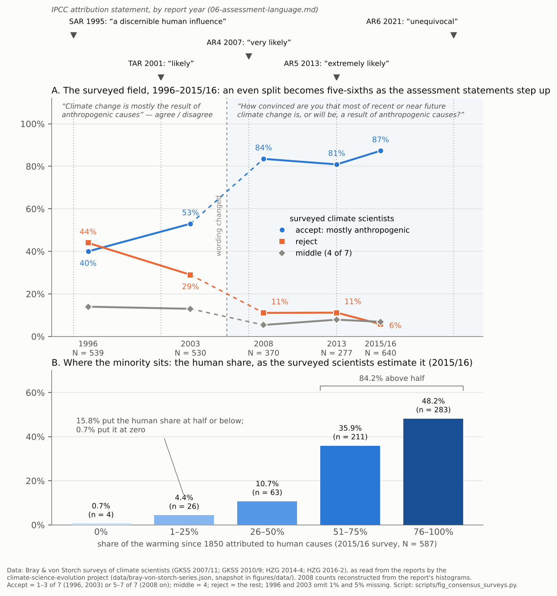

# Case study 03 — paired analyses: "consensus", "manufactured consensus", "settled"

**Status:** v0.1, 2026-10-07. Four pairs (R1–R4) in both modes. The sceptical side's primary statements are quoted through `climate-science-evolution/08` and `09`, which read them in the original; the mainstream side's through `09` and fetches. Two mainstream items are from memory or title only and are flagged. A draft to be checked, not a source.

**Why this case.** `08` §1 sorts the manufactured-consensus claim into four forms and sets the fourth aside as untestable: "'Consensus' is not a scientific category; invoking it substitutes head-counting for evidence." That fourth form is a claim about a *word*, and the other three are stated and answered in frames the word carries — vote, product, settlement, dogma, playbook. The substance of the first three has been tested by `07`, `08` and `09`; this case uses those results and does not redo them. Its own question is what the frames do, on both sides, and what a second look at the table can say.

**Conventions** as in cases 01 and 02. Statement IDs refer to `corpus.md`.

**Two findings that organize the case.** First, FrameNet has no lexical unit for *consensus* at all, but four frames for *agreement*: `Make_agreement_on_action` and `Be_in_agreement_on_action` (parties take on obligations — the political and legal sense), `Be_in_agreement_on_assessment` (cognizers share an opinion on a question — the scientific sense), and `Documents` (the agreement as a paper). Nearly every statement in the case can be sorted by which of the first three it means, and the dispute's central move — Crichton's — is to put science's agreement-on-assessment into the frame of agreement-on-action and then reject it there. Second, *settle* lives in `Make_agreement_on_action` and `Colonization` and nowhere evidential: "the science is settled" is, lexically, either a negotiated settlement or a closed frontier, which is why the phrase is weak for the side it is attributed to and useful to the side that quotes it.

---

## Pair R1 — What "consensus" is: "the business of politics" vs. "97%"

### The statements

S side:

> I regard consensus science as an extremely pernicious development that ought to be stopped cold in its tracks. Historically, the claim of consensus has been the first refuge of scoundrels; it is a way to avoid debate by claiming that the matter is already settled. Whenever you hear the consensus of scientists agrees on something or other, reach for your wallet, because you're being had. (S-1, Crichton 2003)

> Let's be clear: the work of science has nothing whatever to do with consensus. Consensus is the business of politics. Science, on the contrary, requires only one investigator who happens to be right, which means that he or she has results that are verifiable by reference to the real world. In science consensus is irrelevant. What is relevant is reproducible results. The greatest scientists in history are great precisely because they broke with the consensus. (S-1)

> We often hear that there is a "scientific consensus" about climate change. But as far as the computer models go, there isn't a useful consensus at the level of detail relevant to assessing human influences. (S-8, Koonin 2014)

> there is no overarching consensus on MBH98/99. […] In a real sense the paleoclimate results of MBH98/99 are essentially irrelevant to the consensus on climate change. (S-4, Wegman 2006)

> There was a consensus at the meeting on some important issues, but not at all the strong consensus the media promulgates (S-9, Koonin's statement of the APS workshop)

M side:

> Of all the papers, 75% fell into the first three categories, either explicitly or implicitly accepting the consensus view; 25% dealt with methods or paleoclimate, taking no position on current anthropogenic climate change. Remarkably, none of the papers disagreed with the consensus position […] the scientific consensus might, of course, be wrong (M-1, Oreskes 2004)

> the debate on the authenticity of global warming and the role played by human activity is largely nonexistent among those who understand the nuances and scientific basis of long-term climate processes (M-2, Doran & Zimmerman 2009)

> 97–98% of the climate researchers most actively publishing in the field surveyed here support the tenets of ACC (M-3, Anderegg et al. 2010)

> Among abstracts expressing a position on AGW, 97.1% endorsed the consensus position that humans are causing global warming. […] An accurate perception of the degree of scientific consensus is an essential element to public support for climate policy […] there is a significant gap between public perception and reality (M-4, Cook et al. 2013)

> Ninety-seven percent of scientists agree: #climate change is real, man-made and dangerous. (M-5, @BarackObama, 2013)

> Consensus on consensus confirms 97 per cent of experts are convinced people are changing the climate […] Global warming is the most serious issue of our age and scientists can now focus their efforts on addressing it (M-6, Bristol release on Cook et al. 2016)

> The Scientific Consensus on Climate Change as a Gateway Belief (M-7, van der Linden et al. 2015, title)

### Mode A — FrameNet-literal annotation

| Side | Span | Target | FrameNet frame | Frame elements | Note |
|---|---|---|---|---|---|
| both | CONSENSUS | consensus.n | — | — | **(gap)** — no lexical unit. The nearest, agreement.n, has four frames; see the next rows. |
| S | the claim of consensus … is a way to avoid debate by claiming that the matter is already SETTLED | settle.v | `Make_agreement_on_action` (or `Colonization`) | Parties = (the scientists); Obligation = (to act) | Crichton reads "settled" in the agreement-on-action sense: the matter closed by the parties' deal, not by evidence. |
| S | Consensus is the BUSINESS of politics | business.n | `Businesses` | Business = consensus; (owner) = politics | Consensus as politics' trade; `Make_agreement_on_action` by implication. |
| S | reach for your WALLET, because you're being HAD | wallet.n; get.v ("had") | `Containers`; `Intentional_deception` | Deceiver = whoever claims consensus; Victim = you | The con-man ICM of case 01 P3, here aimed at the word itself. |
| S | the first REFUGE of SCOUNDRELS | refuge; scoundrel | — | — | **(gaps)**; the sentence is Johnson's "patriotism is the last refuge of a scoundrel" with the noun swapped — a quotation metonym. |
| S | requires only one INVESTIGATOR who happens to be right … results that are VERIFIABLE by reference to the real world … REPRODUCIBLE results | investigator; verifiable.a; reproducible | —; `Verification`; — | Inspector = anyone; Unconfirmed_content = the results | The lone-investigator ICM; "verifiable" and "reproducible" are the evidential vocabulary the sentence sets *against* agreement. |
| S | there isn't a USEFUL consensus at the LEVEL OF DETAIL relevant to assessing human influences | useful.a; level of detail | `Usefulness`; — | Entity = consensus; Purpose = assessing human influences | A scope qualifier: consensus conceded at one grain, denied at another. |
| S | no overarching consensus on MBH98/99 … essentially IRRELEVANT to the consensus on climate change | irrelevant.a | `Being_relevant` (negated) | Phenomenon = MBH98/99; Endeavor = the consensus on climate change | Two consensuses in one report — on a method, and on the climate — and the report says the first does not bear on the second. |
| S | a consensus at the meeting on some important issues, but not at all the STRONG consensus the media PROMULGATES | strong.a; promulgate | (`Level_of_force_exertion` by extension); — | — | Consensus graded by strength; "promulgate" **(gap)** — a law or decree issued. |
| M | ACCEPTING the consensus view … none of the papers DISAGREED with the consensus position | accept; disagree | (`Agree_or_refuse_to_act`?); `Be_in_agreement_on_assessment` (negated) | Cognizers = the papers' authors; Question = attribution; Opinion = the TAR's | The scientific sense: cognizers and a question. |
| M | the scientific consensus MIGHT, of course, be WRONG | might; wrong | `Possibility`; `Correctness` (negated) | — | The author of the first measurement says the measured thing can be false — consensus as indicator, not proof. |
| M | the DEBATE … is largely NONEXISTENT among those who UNDERSTAND the nuances | debate; nonexistent; understand.v | —; `Existence` (negated); `Grasp` | Cognizer = the experts | The debate's existence is scoped to a group defined by expertise. |
| M | CONVINCED by the evidence / UNCONVINCED … SUPPORT the TENETS of ACC … EXPERT credibility | convinced.a; support.v; tenet; expert.n | `Certainty`; `Taking_sides` / `Supporting`; —; `Expertise` | Cognizer = researchers; Content = ACC; Side = ACC | "Tenets" **(gap)** — a doctrine's articles; "support" is listed under `Taking_sides`, a partisan frame, as well as `Evidence`. |
| M | ENDORSED the consensus POSITION … expressed no POSITION | endorse.v; position.n | `Taking_sides`; (`Posture` / `Locale_by_collocation`) | Cognizer = the abstracts' authors; Issue = AGW; Side = the consensus | endorse.v is in `Taking_sides` only: the counting frame is a sides frame. |
| M | a significant GAP between public PERCEPTION and REALITY | gap.n; perception.n; reality | `Natural_features`; `Perception_experience`; (`Existence`) | Locale = the gap | A physical opening between what is seen and what is; "consensus messaging" is the bridge. |
| M | Ninety-seven percent of scientists AGREE: #climate change is REAL, MAN-MADE and DANGEROUS | agree.v; real.a; man-made; dangerous.a | `Be_in_agreement_on_assessment`; `Artificiality` / `Existence`; (Artificiality criterion); `Risky_situation` | Cognizers = 97% of scientists; Opinion = real, man-made, dangerous | The agreement frame is the scientific one; the third predicate was not in the study. |
| M | 97 per cent of experts are CONVINCED people are changing the climate … scientists can now FOCUS their efforts on ADDRESSING it | convinced.a; focus.v; address.v | `Certainty`; (`Attention`); (`Resolve_problem`) | Cognizer = experts | The count as closure: argument ends, work begins. |
| M | a GATEWAY BELIEF | gateway; belief | —; `Religious_belief` / `Certainty` / `Awareness` | — | gateway **(gap)**; the consensus as a gate through which other beliefs pass — persuasion as architecture. |

**What Mode A gave for R1.** The central word is absent from the lexicon and its nearest relative is four-way ambiguous, which is the whole dispute in one entry: Crichton's sentences all live in `Make_agreement_on_action`/`Businesses`/`Intentional_deception` (a deal, a trade, a con), the measurement papers in `Be_in_agreement_on_assessment`/`Certainty`/`Expertise` (cognizers, a question, convincement, skill). Two things cut across. The measurement papers' own verbs — *endorse*, *support* — are listed in `Taking_sides`, a partisan frame: FrameNet records that counting endorsements is counting sides. And the sceptical statements with scope qualifiers (Koonin's "at the level of detail", Wegman's two consensuses, the APS "some important issues") are doing something the slogan does not: conceding agreement at one grain and denying it at another.

### Mode B — frames, metaphors, construal, scenario

**The frame substitution.** Crichton's passage is the cluster's founding rhetorical move: take science's convergence — many investigators, independent lines of evidence, one answer — and place it in the frame of political agreement (a majority, a deal, pressure to conform, "the business of politics"), where it is indeed no evidence of anything; then declare that in science "consensus is irrelevant" and "what is relevant is reproducible results". Entailments pressed: a head-count is not a proof; the lone investigator can be right against the crowd (the Galileo ICM: "the greatest scientists in history … broke with the consensus"); whoever invokes consensus is avoiding debate (the con: "reach for your wallet"). Entailments hidden: (a) that reproducible results are *why* investigators converge, so the agreement-on-assessment is downstream of exactly the evidence the sentence sets against it; (b) that "one investigator who happens to be right" is known to be right only when others reproduce the result — the lone-genius story ends in a consensus; (c) that the passage is itself an appeal to a person's authority (a novelist's lecture) rather than to reproducible results. The sentence "If it's consensus, it isn't science" is true of `Make_agreement_on_action` and false of `Be_in_agreement_on_assessment`, and it works because English has one word for both.

**The measurement frame, and what it concedes.** The mainstream's reply was to *measure* the agreement — abstracts (Oreskes, Cook), survey answers (Doran), publication records (Anderegg) — and report a number. The frame is CONSENSUS AS A QUANTITY, with a metonym, "97%", standing for the whole epistemic state, a "gap" between perception and reality that messaging should close, and (van der Linden) belief in the consensus as a "gateway" to other beliefs — persuasion as a building with a door. Entailments pressed: the agreement is near-total; the public underestimates it; correcting the number corrects the belief. Entailments hidden: (a) what proposition the 97% agree to — the studies differ (`09` §4.2: "significant contributing factor" for Doran; "humans are causing" unquantified for Cook; "most" for the IPCC), and the number is of a filtered set (Cook's 66.4% "no position" excluded; Anderegg's by publication count; Doran's 77 of 3,146); (b) that the raters of the largest study "themselves endorsed the scientific consensus" (Cook's own words); (c) that counting endorsements accepts Crichton's frame — consensus as a count of sides — which the measurement papers' own verbs (`Taking_sides`) confirm. The field's strongest statements of its position never use the count: Oreskes's "the scientific consensus might, of course, be wrong" treats the measured agreement as an indicator, and the assessments state calibrated likelihoods per proposition (R3). The count was built, as Cook's first sentence says, for "public support for climate policy" — and "persuade rather than inform" is Koonin's charge. The frame concession here is the mirror of case 02's: the mainstream adopted the other side's picture of what consensus is, in order to show it had one.

**The slide to "dangerous".** The tweet's third predicate is the UNFCCC's word (Article 2: "dangerous anthropogenic interference"), not the studies'. "Real, man-made and dangerous" moves in one breath from existence (`Existence`) to cause (`Artificiality`'s criterion) to risk (`Risky_situation`) under one percentage; the studies measured the first two in various wordings and none measured the third. It is the mainstream's version of the sceptical side's headline/body asymmetry (case 02): the strongest word is where the fewest readers will check it.

**Granularity.** The sceptical side's careful statements are scope statements: Koonin concedes a consensus and denies "a useful consensus at the level of detail relevant to assessing human influences"; Wegman separates "the consensus on climate change" (which he affirms, with "the Earth is getting warmer") from consensus on one reconstruction; the APS finding grants "a consensus … on some important issues" and denies "the strong consensus the media promulgates". These are the typology of `09` in the sceptics' own words: agreement on existence and sign (A-type), argument about magnitude (Q-type). "The consensus" — definite article, singular — hides which grain is meant, on both sides: the 97% studies measure the A-type question and are quoted as if they settled the Q-type ones; the sceptical slogan denies consensus as such while its authors concede it at the grain that was measured.

**Scenario / narrative.** S: the lone investigator against the crowd, and the con (a crowd that says "settled" has something to sell). M: the misinformed public, the gap, the bridge, and closure ("scientists can now focus their efforts on addressing it"). Each narrative needs the other: the con needs a salesman (the 97% campaign supplies one), the gap needs a doubt-industry to have opened it (R2).

### Substance notes (not framing)

The surveyed field's agreement on attribution rose from an even split in 1996 (40 accept, 44 reject) to five-sixths by 2008 and 87 per cent by 2015/16 (`09` §4.1; Figure R-1 below), while published dissent fell below one per cent of papers; the surveyed minority is 6–14 per cent depending on survey and proposition, "most of it a disagreement about the human share rather than its existence" (`09` §4.6). The 97 per cent figures are post-shift measurements at different definitions of expert and proposition (`09` §4.2), the citers of the consensus-measurement papers are 51–74 per cent social-science works (`08` §2.4), and the APS critics questioned by Koonin in 2014 conceded the warming, the anthropogenic CO₂ rise and an anthropogenic influence, "drawing the line at the fraction and the sensitivity" (`08` §4.1). So: Crichton's claim that consensus is irrelevant to science is false of agreement-on-assessment and true of agreement-on-action; the 97 per cent is a real measurement of a narrow question; and the grain at which there is consensus is exactly the grain at which the sceptical side's careful statements concede it.

### Second looks

*If a friend says:* "Science isn't done by consensus — if it's consensus it isn't science. The 97% is just a head-count."

> "Consensus" has two pictures inside it: parties agreeing what to do — a vote, a settlement — and experts agreeing on what the evidence shows. Crichton's line attacks the first and says the second doesn't exist; but a result is trusted when independent lines of evidence converge, and that convergence is what the agreement tracks, not what it replaces. The 97% figures do count heads, and the counting has weaknesses worth knowing — what question was asked, which papers were counted, who did the rating. The better question is *what* the experts agree on, and at what grain: near-agreement that warming is real and mostly human-caused, open argument about how sensitive the climate is. Koonin and the critics at the 2014 APS workshop conceded the first in the same breath as they denied "the strong consensus".

*If I say (or a mainstream friend says):* "97% of scientists agree it's real, man-made and dangerous — case closed."

> "97%" is a count of papers or people answering one question, and the studies asked whether warming is real and human-caused, in different wordings — not whether it's dangerous; that word came in with the tweet. Counting heads also concedes the other side's picture of consensus as a vote. The stronger ground is the convergence of independent evidence — ocean heat, the pattern of warming, the response to eruptions — and the assessments' calibrated statement, which says "extremely likely" rather than "closed". And "the consensus" hides its grain: near-total on existence and cause, open on sensitivity. Saying that disarms the head-count objection instead of inviting it.

---

## Pair R2 — Who made it: "manufactured consensus" vs. "manufactured doubt"

### The statements

S side:

> I have never witnessed a more disturbing corruption of the peer-review process than the events that led to this IPCC report. […] nearly all worked to remove hints of the skepticism with which many scientists regard claims that human activities are having a major impact on climate. […] (the effect:) to deceive policy makers and the public […] (the remedy:) abandon the entire IPCC process (S-2, Seitz 1996)

> The IPCC: Institutionalized "Scientific Cleansing"? (S-3, GCC 1996, title)

> how political bodies act to control scientific institutions, how scientists adjust both data and even theory to accommodate politically correct positions, and how opposition to these positions is disposed of. (S-5, Lindzen 2008)

> The IPCC is pre-programmed to produce reports to support the hypotheses of anthropogenic warming […] Because we are not predisposed to believe climate change is caused by human greenhouse gas emissions, we are able to look at evidence the IPCC ignores. (S-6, NIPCC 2008)

> the climate community has prematurely elevated a scientific hypothesis on human-caused climate change to a ruling theory through claims of a consensus […] Premature theories enforced by an explicit consensus building process harm scientific progress […] If the IPCC found that climate change was not being affected by human alteration of the atmosphere or that it is not 'dangerous,' the UNFCCC would not need it to exist (S-7, Curry 2017)

> the long game of telephone that starts with the research literature and runs through the assessment reports to the summaries of the assessment reports and on to the media coverage. There are abundant opportunities to get things wrong—both accidentally and on purpose […] I had inadvertently broken some code of silence, like the Mafia's omerta […] not some secret cabal, but rather a self-reinforcing alignment of perspectives and interests (S-9, Koonin 2021)

> the global warming bandwagon first started to roll behind the gravy train of the UN Inter-governmental Panel on Climate Change […] the sophisticated scientific brainwashing that has been inflicted on the public […] the prevailing paradigm of climate alarmism […] members of the Establishment have spoken declamatory words on the issue, and the kingdom's subjects are expected to listen. (S-10, Carter 2006)

M side:

> There has been no dishonesty, no corruption of the peer-review process and no bias--political, environmental or otherwise […] Uncertainties have not been suppressed. […] The rules of procedure were strictly followed […] There appears to be a concerted and systematic effort by some individuals to undermine and discredit the scientific process (M-8, the 1996 replies)

> The complaints are not entirely groundless. […] there is some evidence that the revision process did result in a subtle shift in the relative weight given to different types of arguments, and that — not surprisingly — this shift tended to favour arguments that aligned with the report's broad conclusions […] procedural criticism is not allowed to throw out the baby with the bathwater […] semantic arguments that risk losing the wood in the trees […] (an assessment) that merely seeks to impugn the motives of scientific participants by alleging that they are responding to political pressures. (M-9, *Nature* 1996)

> a playbook that the tobacco industry first developed: Discredit the messenger, foster doubt and denial about the science, and call for additional research. (M-13, Markey as quoted by Rahmstorf 2012)

> Vested interests and political agents have long opposed political or regulatory action in response to climate change by appealing to scientific uncertainty. (M-14, Lewandowsky et al. 2015)

> Merchants of Doubt: How a Handful of Scientists Obscured the Truth on Issues from Tobacco Smoke to Global Warming (M-15, Oreskes & Conway 2010, title)

### Mode A — FrameNet-literal annotation

| Side | Span | Target | FrameNet frame | Frame elements | Note |
|---|---|---|---|---|---|
| S | a disturbing CORRUPTION of the peer-review process … to DECEIVE policy makers and the public … ABANDON the entire IPCC process | corruption; deceive.v; abandon.v | — (corrupt.a → `Morality_evaluation`); `Intentional_deception`; `Abandonment` | Deceiver = the report's makers; Victim = policy makers and the public; Agent = (we); Theme = the IPCC process | corruption **(gap)** as a noun; the adjective's frame is moral. A process that has gone bad, a public deceived, a remedy of walking away. |
| S | Institutionalized "SCIENTIFIC CLEANSING"? | cleansing | — | — | **(gap)**; in 1996 the compound evokes "ethnic cleansing" (Bosnia): the removal of a population — here of sceptical sentences — from a territory. |
| S | political bodies act to CONTROL scientific institutions … POLITICALLY CORRECT positions … opposition … is DISPOSED OF | control.v; politically correct; dispose of | `Being_in_control`; —; (`Removing`) | Agent = political bodies; Theme = institutions | Control, orthodoxy and disposal: the institution as a captured machine. |
| S | the IPCC is PRE-PROGRAMMED to produce reports … we are not PREDISPOSED … we are not BIASED | pre-programmed; predisposed; biased | — (program.n → `Project`); —; — | — | **(gaps)**; the computer ICM: an output fixed before the input. The counter-panel claims the absence of the same property for itself. |
| S | PREMATURELY ELEVATED a scientific hypothesis … to a RULING theory … ENFORCED by an explicit consensus building process … the MANDATE from the UNFCCC … would not NEED it to EXIST | premature.a; elevate; rule (ruling); enforce.v; mandate.n; need.v; exist.v | `Relative_time`; (`Change_position_on_a_scale`); `Leadership`; `Enforcing`; `Deny_or_grant_permission`; `Needing`; `Existence` | Focal_occasion = the elevation (too early); Leader = the theory; Governed = the field; Rule = the consensus; Authority = the UNFCCC | A theory crowned too early and then enforced as a rule, under an authority's mandate, by a body whose existence depends on the finding — four frames of governance in two sentences. "Ruling theory" is Chamberlin's (1890) term for the opposite of multiple working hypotheses. |
| S | the long game of TELEPHONE … FILTER after FILTER to be PACKAGED for various audiences … a code of silence, like the Mafia's OMERTA … AMMUNITION to the deniers … not some secret CABAL, but rather a self-reinforcing ALIGNMENT of perspectives and interests | telephone; filter; package.v; omerta; ammunition.n; cabal; alignment | —; —; `Placing`; —; `Ammunition`; —; — | Agent = the relay (telephone); Theme = information (packaged) | **(gaps)** for the relay game, the filter, omerta, cabal and alignment; the war frame (ammunition) is lexical. The sentence that names and rejects the cabal is the statement's retreat from conspiracy to structure. |
| S | the global warming BANDWAGON … the GRAVY TRAIN … BRAINWASHING … the prevailing PARADIGM … the ESTABLISHMENT … the KINGDOM'S SUBJECTS are expected to listen | bandwagon; gravy train; brainwash; paradigm; Establishment; subjects | — ; — ; — ; — ; — ; (`Leadership`: Governed) | — | **(gaps)** throughout: two vehicles (a wagon to jump on, a train that feeds), a washed brain, Kuhn's word, and a monarchy whose subjects must listen. |
| M | no DISHONESTY, no CORRUPTION … and no BIAS … Uncertainties have not been SUPPRESSED … the RULES of procedure were strictly FOLLOWED | dishonesty; corruption; bias; suppress.v; rule.n; follow | —; —; —; `Self_control` (only sense); (`Compliance`) | Protagonist = the authors; Norm = the rules | FrameNet's only "suppress" is self-suppression — there is no frame for suppressing others' views, on either side's reading. The reply is in the frame of `Compliance`. |
| M | a CONCERTED and SYSTEMATIC EFFORT by some individuals to UNDERMINE and DISCREDIT the scientific process | concerted; systematic; undermine; discredit | —; —; (`Cause_harm` by extension); (`Judgment_communication`) | Assailant = some individuals; Victim = the scientific process | The mainstream's 1996 statement is already the organized-attack frame — coordinated, systematic, aimed at credibility. |
| M | The complaints are not entirely GROUNDLESS … a subtle SHIFT in the relative WEIGHT given to different types of arguments … ALIGNED with the report's broad conclusions | groundless; shift; weight; align | —; `Change_position_on_a_scale`; (BALANCE image); — | Item = the weight of arguments | The editorial concedes the drift in the sceptics' own direction and uses the same word Koonin will use twenty-five years later: *aligned*. |
| M | throw out the BABY with the BATHWATER … losing the WOOD in the TREES … IMPUGN the MOTIVES of scientific participants | (proverbs); impugn; motive.n | —; —; `Reason` | — | Two proportion proverbs — a part mistaken for the whole — and the naming of the move both sides make: the attribution of motive. |
| M | a PLAYBOOK that the tobacco industry first developed: DISCREDIT the messenger, FOSTER doubt and denial … VESTED INTERESTS and POLITICAL AGENTS … MERCHANTS of doubt | playbook; discredit; foster; vested interests; agent; merchant | — (sport/strategy image); (`Judgment_communication`); (`Cause_to_start`); —; —; — | — | **(gaps)** for playbook, vested interest, merchant: the mainstream's institutional vocabulary is outside the lexicon as completely as the sceptical side's. Doubt as a product with a seller. |

**What Mode A gave for R2.** Almost nothing, and that is the finding: corruption, cleansing, pre-programmed, cabal, omerta, bandwagon, gravy train, brainwashing, paradigm, Establishment on one side; playbook, vested interests, merchants, denial-industry on the other — the entire vocabulary of the institutional and sociological claims, in both directions, is absent from FrameNet. What the lexicon does hold is governance (`Leadership`, `Enforcing`, `Deny_or_grant_permission`, `Compliance`, `Being_in_control`), deception (`Intentional_deception`), war (`Ammunition`) and the moral adjective (`Morality_evaluation`), and one oddity worth keeping: *suppress* has only the self-control sense, so "dissent was suppressed" and "uncertainties have not been suppressed" are both using a frame the lexicon does not give them. The institutional layer, like the technical layer in cases 01–02, is where the inferential work is done by scripts the analyst must write.

### Mode B — frames, metaphors, construal, scenario

**Two factories.** The cluster's master frame is MANUFACTURE: a Maker, a Product, a Design, a Buyer. On one side the product is consensus — "pre-programmed" (an output fixed before the input), a "consensus building process" that "enforces" a "ruling theory", "scientific cleansing", "brainwashing", a "Party Line" (case 02). On the other the product is doubt — "merchants", a "playbook", "vested interests", "manufactured uncertainty". Entailments pressed, identically: intent; design; uniformity; a hidden workshop; a buyer who does not know what he has bought. Entailments hidden, identically: that agreement can emerge without design and doubt can be sincere; that both frames leave no role for ordinary disagreement about a hard problem. Figure R-1 is the record's answer to the first factory: the field was split when the SAR said "discernible" in 1995 and moved to five-sixths over the next twelve years as the attribution papers accumulated — which is what emergence looks like and not what manufacture looks like (a factory ships at once). The record's answer to the second factory is `08` §4's reading of the Global Climate Coalition's own documents: a 1995 primer that conceded what a 1996 press packet denied — which is what manufacture looks like, for one organization, in one decade, and is not evidence about every sceptic since.

**The gradient from conspiracy to structure.** The sceptical statements run from a secret agent to no agent at all: Seitz names Santer; the GCC names a cleansing; the NIPCC a programmed machine; Lindzen "political bodies"; Curry a "community" under a "mandate"; Koonin 2021, explicitly, "not some secret cabal, but rather a self-reinforcing alignment of perspectives and interests". The mainstream runs the same gradient: "a concerted and systematic effort by some individuals" (1996) to "vested interests and political agents" (2015) to Lewandowsky's "seepage", a leak with no leaker. The structural end of each gradient is the defensible one, and it is nearly the same sentence on both sides — "aligned with the report's broad conclusions" (*Nature* 1996), "self-reinforcing alignment of perspectives and interests" (Koonin 2021), "self-reinforcing feedback mechanism" (Wegman 2006), "seepage … inadvertent" (Lewandowsky 2015). Alignment, feedback and seepage are each a physical image of a process without a designer; they are where both sides go when asked to show the factory.

**Governance frames.** Curry's sentence stacks four: a hypothesis "elevated" (rank), to a "ruling theory" (`Leadership`: the theory as monarch, the field as governed — Chamberlin's 1890 term for the enemy of multiple working hypotheses), "enforced" (`Enforcing`: consensus as a rule with police), under a "mandate" (`Deny_or_grant_permission`: the UNFCCC as the authority that licensed the finding). Carter's "the kingdom's subjects are expected to listen" is the same monarchy from the public's side; Monckton's "Party Line" the same state from the other century. The frames entail that dissent is disobedience and assent is compliance, which converts every agreeing scientist into a subject. Hidden: the mechanism by which a treaty's mandate would reach a reviewer's judgment of a paper — the step the inquiries looked for and did not find (`08` §5).

**The relay.** Koonin's "long game of telephone … filter after filter … packaged for various audiences" is the most specific of the sceptical frames and the one `07` tests directly: distortion by relay from literature to chapters to summaries to press. The frame's entailment is that each stage loses or bends; `07` §4 finds the summaries did not raise the chapters' likelihoods across six cycles, while the press and publisher layer (case 01's "proving", "the true global warming trend") does bend — so the relay is real and its bend is at the stage Koonin's own 2014 essay did not name (the media) rather than the one it did (the summaries). "Accidentally and on purpose" keeps both the structural and the intentional reading available in one clause.

**The two "so-called"s, and a third.** The GCC's "the amount of so-called greenhouse gases" (1996), Carter's "the so-called climate sceptics" (2006), Rahmstorf's "sogenannte 'Klimaskeptiker'" (2012): the same `Being_named` move — this name is only a name — applied to the central nouns from every direction. Each side marks the other's term as a label and its own as a description.

**Scenario / narrative.** S: the captured institution — a story told unchanged from Seitz (1996) to Curry (2017), with the villain migrating from a named lead author to "the climate community", the victim "policy makers and the public", and the remedy "abandon the process" (1996) or "red team" (2014–21). M: the organized attack — told unchanged from the AMS/UCAR letter (1996) to Lewandowsky (2015), villain "some individuals" then "vested interests", victim "the scientific process" then "the public", remedy "assess the science" (*Nature*) or "inoculation" (the gateway-belief literature). In Stone's terms both are *intentional* causal stories, and each side's structural retreat is a concession that the intentional story is too strong.

### Substance notes (not framing)

The Chapter 8 deletions Seitz listed are real and each has a counterpart in the published chapter's own Summary (`08` §4); the *Nature* editorial's concession of a "subtle shift" is the fairest contemporary reading; the eight inquiries of 2010–11 and the InterAcademy review found no fabrication and recommended procedural reforms that were adopted (`08` §5). Across six assessment cycles no Summary for Policymakers raised a chapter's likelihood (`07` §4). The surveyed field was evenly split in 1996 and reached five-sixths by 2008 (Figure R-1; `09` §4.1), so the SAR's "discernible" did precede the field's majority — the sceptical side's best institutional point — and the field's movement afterwards tracked the attribution literature's adoption (`08` §2.4). The surveys' "unconvinced" report *more* media exposure than the convinced, not less (`08` §2.1); the minority's returns were published and answered in the main journals (`09` §4.6); and the most recent model problem was models running too hot (`08` §2.3). On the other side, the "merchants" case is documented for the tobacco industry and, from its own papers, for the Global Climate Coalition; extended to every sceptic, including scientists who published their objections in the field's journals, it is the motive-attribution the *Nature* editorial warned against in 1996.

### Second looks

*If a friend says:* "The consensus was manufactured — the IPCC was set up to find human causation, and anything else gets screened out."

> "Manufactured" is a factory picture: a product made to a design, on purpose. There's a real episode under it — in 1996 a chapter was revised after acceptance and three cautious sentences went; the deletions are real — and a real sequence: the 1995 "discernible human influence" came before most scientists agreed, and a 1996 survey of the field split 40 to 44. What the factory picture hides is what happened next: over twelve years the surveyed field moved to five-sixths as the attribution papers came in, the critics' papers were published and answered in the main journals, and the models' latest problem was running too hot, not too cool. One more thing worth knowing: the other side's picture is a factory too — "merchants of doubt", a "playbook" — and each says the other's position is a product. The question that cuts through both is which claims were tested and what the tests showed.

*If I say (or a mainstream friend says):* "It's manufactured doubt — the same playbook the tobacco companies used."

> "Playbook" and "merchants" say the other side's doubt is a product, sold. That is documented for a 1990s industry coalition whose own primer conceded what its press packet denied. Extended to every sceptic — including scientists who published their objections in the journals and had them answered — it is the move the *Nature* editorial warned against in 1996, impugning motives instead of assessing the science, and it hands the friend the exit "I'm being called a shill." The structural version both sides now use — "an alignment of interests", "seepage" — is weaker as an accusation and much more defensible.

---

## Pair R3 — Settled, unsettled, and the calibrated middle

### The statements

S side:

> The idea that "Climate science is settled" runs through today's popular and policy discussions. Unfortunately, that claim is misguided. […] The crucial scientific question for policy isn't whether the climate is changing. That is a settled matter: The climate has always changed and always will. […] Nor is the crucial question whether humans are influencing the climate. That is no hoax: There is little doubt in the scientific community that continually growing amounts of greenhouse gases in the atmosphere, due largely to carbon-dioxide emissions from the conventional use of fossil fuels, are influencing the climate. […] they should not be dismissed with the mantra that "climate science is settled." […] rigidly promulgating the idea that climate science is "settled" (or is a "hoax") demeans and chills the scientific enterprise, retarding its progress in these important matters. Uncertainty is a prime mover and motivator of science and must be faced head-on. It should not be confined to hushed sidebar conversations at academic conferences. (S-8, Koonin 2014)

> the science is far from settled… proposed efforts to mitigate climate change by reducing GH gas emissions are premature and misguided (S-6, NIPCC 2008)

> But the science is not settled. (S-9, Koonin 2021, closing sentence)

> Each such alarmist article is larded with words such as "if ", "might", "could", "probably", "perhaps", "expected", "projected" or "modelled" - and many involve such deep dreaming, or ignorance of scientific facts and principles, that they are akin to nonsense. (S-10, Carter 2006)

> Overconfident assertions take away the motivation for scientists to challenge the consensus (S-7, Curry 2017)

M side:

> (SAR 1995:) the balance of evidence suggests that there is a discernible human influence on global climate. / (TAR 2001:) […] is likely to have been due to […] / (AR4 2007:) […] is very likely due to […] / (AR5 2013:) It is extremely likely that human influence has been the dominant cause […] / (AR6 2021:) It is unequivocal that human influence has warmed the atmosphere, ocean and land. (M-10)

> (as remembered — unverified:) Such conclusions and theories are then regarded as settled facts. This is the case for the conclusions that the Earth system is warming and that much of this warming is very likely due to human activities. (M-11, NRC 2010)

> Climate debate must not overheat […] The IPCC's Working Group 1 has taken pains, as its full report indicates, to meet scientific criticisms of its conclusions head on (M-9, *Nature* 1996)

> the scientific consensus might, of course, be wrong (M-1, Oreskes 2004)

### Mode A — FrameNet-literal annotation

| Side | Span | Target | FrameNet frame | Frame elements | Note |
|---|---|---|---|---|---|
| both | "Climate science is SETTLED" / a SETTLED matter / far from SETTLED / not SETTLED / SETTLED facts | settle.v (settled.a has no LU) | `Make_agreement_on_action`; `Colonization` | Parties = (the scientists); Obligation = (what to do); or Colonists = (science); New_area = (the question) | The two lexical bases of "settled": a dispute closed by the parties' agreement, or a frontier closed by settlers. Neither is evidential. The dust-settling sense (a process coming to rest) is not in FrameNet either. |
| S | UNSETTLED (the book's title) | unsettled.a | `Emotion_directed` | Experiencer = (the reader); Stimulus = the science | FrameNet's only sense is a person's state. The title says the science is not settled and leaves the reader so. |
| S | That is a SETTLED MATTER: The climate has always changed and always will | settle.v; matter.n | `Make_agreement_on_action`; (`Topic`) | — | Koonin uses "settled" affirmatively, twice, for the existence-level claims — change, and human influence — before denying it for magnitude. |
| S | the MANTRA that "climate science is settled" … rigidly PROMULGATING the idea … DEMEANS and CHILLS the scientific enterprise … HUSHED SIDEBAR conversations | mantra; promulgate; demean; chill.v; hushed | —; —; —; `Cause_temperature_change`; — | Agent = those who promulgate; Item = the scientific enterprise (chilled) | mantra, promulgate, demean, hushed **(gaps)**: a chant (religion), a decree (law), a temperature (the enterprise cooled), a whisper. |
| S | That is no HOAX … "settled" (or is a "HOAX") | hoax | — | — | **(gap)**. Koonin rejects both slogans, twice: "That is no hoax" of the human influence, and "settled" (or "hoax") in one pair of quotation marks — the one place in the corpus where the two sides' slogans are held at the same distance. |
| S | far from settled … PREMATURE and MISGUIDED | far; premature.a; misguided | (`Locative_relation`, distance image); `Relative_time`; (`Prevarication` by root) | Focal_occasion = mitigation (too early) | Settledness as a place one can be far from; action as a birth too early. |
| S | LARDED with words such as "if", "might", "could", "probably", "perhaps", "expected", "projected" or "modelled" … DEEP DREAMING | lard.v; dream | (`Apply_heat`/cooking image); (`Sleep`?) | — | The calibrated vocabulary itself, listed as evasion: the hedges are fat on the meat. |
| S | OVERCONFIDENT assertions | overconfident | — (confident.a → `Certainty`) | Cognizer = the assessments | **(gap)**; the opposite charge — too much certainty — from the same side (Curry) that charges too little (Carter). |
| M | the BALANCE of EVIDENCE suggests … a DISCERNIBLE human influence | balance.n; evidence.n; discernible | (BALANCE image); `Evidence`; (`Obviousness` / `Becoming_aware`) | Support = the evidence; Proposition = a human influence | 1995: weighed, not counted; "discernible" = perceptible, the weakest detection word. |
| M | LIKELY … VERY LIKELY … EXTREMELY LIKELY | likely.a | `Likelihood` | Hypothetical_event = human causation of most warming | The ladder: one frame, three rungs, each a defined probability band. |
| M | It is UNEQUIVOCAL that human influence has WARMED the atmosphere, ocean and land | unequivocal; warm.v | —; `Cause_temperature_change` | Agent/Cause = human influence; Item = atmosphere, ocean, land | unequivocal **(gap)**: no two readings. Note the agentive frame of warm.v — human influence as the warmer. |
| M | regarded as SETTLED FACTS … likelihood of subsequently being found to be WRONG is VANISHINGLY SMALL | settle.v; fact; wrong; small.a | `Make_agreement_on_action`; —; `Correctness`; `Size` | — | (unverified) The one mainstream use of "settled" in the corpus, and it immediately redefines the word in `Correctness`/`Likelihood` terms. |
| M | Climate debate must not OVERHEAT … meet scientific criticisms of its conclusions HEAD ON | overheat.v; head on | `Cause_temperature_change`; (`Confronting_problem`) | Item = the debate | The debate's temperature, from the other side: Koonin's "chills" and *Nature*'s "overheat" are one metaphor with opposite complaints. |
| M | the scientific consensus MIGHT, of course, be WRONG | might; wrong | `Possibility`; `Correctness` | — | The measurement's author declining "settled". |

**What Mode A gave for R3.** The lexicon settles one thing: "settled" has no evidential sense. Its frames are a deal between parties and a frontier closed by settlers; "unsettled" is a person's state. So the slogan "the science is settled" — which in this corpus appears only inside the sceptical side's quotation marks — says, lexically, that the parties agreed, which is Crichton's frame handed back to him. The mainstream's own words are elsewhere: a `Likelihood` ladder (likely, very likely, extremely likely) with defined bands, "discernible" (perceptible), "unequivocal" (no second reading), and the measurement author's "might, of course, be wrong". And the two sides' complaints about the debate's state are one metaphor: *Nature* 1996 fears it will "overheat", Koonin 2014 that it "chills"; the sceptical side charges the assessments with both too many hedges (Carter) and too much confidence (Curry).

### Mode B — frames, metaphors, construal, scenario

**Three source domains for one word.** "Settled" can mean a dispute closed by the parties' agreement (law: a settlement, with terms and no verdict), a frontier closed by settlers (a territory no longer open), or a suspension come to rest (dust settles; a process ends by itself). Applied to science, the first concedes Crichton's picture (agreement, not proof), the second makes further inquiry trespass, the third makes the end of argument an inevitability rather than a finding. None says "shown by evidence to a stated likelihood", which is what the assessments actually say, and it is why the phrase does rhetorical work only for the side that quotes it: Koonin's essay opens with it in quotation marks, calls it a "mantra" (a chant, repeated rather than reasoned) and "promulgated" (a decree), and closes his book with its negation. "Unsettled", by FrameNet's one sense, is also a feeling; the title does to the reader what it says of the science.

**The same word at two grains.** Koonin's essay uses "settled" affirmatively for two claims — "That is a settled matter: The climate has always changed and always will", and, of the human influence, "That is no hoax: There is little doubt in the scientific community that continually growing amounts of greenhouse gases … are influencing the climate" — and denies it for the models and the projections. So the sceptical side's most careful statement does not reject settledness; it rejects it at magnitude while asserting it at existence, exactly as R1's scope qualifiers did for consensus. "The science is settled", singular, hides the grain on both sides; the ladder of M-10 is a per-proposition statement that does not.

**Too hedged and too confident.** Carter lists the calibrated vocabulary — "if", "might", "could", "probably", "expected", "projected", "modelled" — as "deep dreaming" and "nonsense": the hedges are lard, evasions. Curry charges "overconfident assertions" that deter challenge. Koonin says uncertainty is "confined to hushed sidebar conversations". The three are compatible only as frames: the assessment language can be read as evasion (too many conditionals) or as dogma (too much certainty) or as concealment (certainties in the summary, doubts in the hallway), and each reading selects the words that fit. `07` §4 tests the third and finds the chapters carry the hedges the summaries are accused of dropping — which Koonin's own sentence concedes: the open questions "are in fact described in the IPCC research reports, although a detailed and knowledgeable reading is sometimes required to discern them."

**The debate's temperature.** "Climate debate must not overheat" (1996) and "chills the scientific enterprise" (2014): both sides image the field's health as a temperature on the subject's own scale, and complain in opposite directions — too hot (political passion) from the journal, too cold (deterred inquiry) from the dissenter. A listener can be asked which complaint fits the piece of science in front of them; usually neither.

**Religion.** "Mantra", "promulgate", "'believing' or 'denying' the science", "The Science" in capitals and quotation marks (S-9), Carter's "devotee" and "climate God", Monckton's "New Superstition" (case 02): the sceptical side's master frame for settledness is dogma — a church, a creed, heretics. Its entailments: that assent is faith and dissent is persecuted. Its hidden premise: that the assessments speak in creeds, when their register is the ladder. The mainstream's mirror is not religion but illness and crime — "denial", "merchants" — which R4 takes up.

### Substance notes (not framing)

The assessments' attribution language stepped from "discernible" (1995) to "likely" (2001), "very likely" (2007), "extremely likely" (2013) and "unequivocal" (2021), each term with a defined band (`06`), and the summaries did not exceed the chapters (`07` §4). What is settled at the A-type grain (warming; human cause of most of it) is stated as such; what is open — sensitivity, narrowed to 2.5–4 °C only in 2020–21 after forty years at 1.5–4.5, with AR5 declining a best estimate; regional change; the 2023–25 acceleration — is stated as open (`03`, `09`). The NRC's "settled facts" sentence, if its wording is as remembered, is the mainstream's one careful use of the word and defines it epistemically; the sentence should be checked. Koonin's "That is a settled matter" for climate change in general is true and not in dispute; his "not settled" for sensitivity was true in 2014 and partly overtaken by 2021 (`08` §4).

### Second looks

*If a friend says:* "They keep saying the science is settled — but science is never settled."

> Who said it? In the material here the phrase turns up only inside quotation marks on the sceptical side; the assessments say "extremely likely" and "unequivocal" about specific things — that warming is happening and that humans are its main cause — and give ranges and "low confidence" about others: how sensitive the climate is, what happens regionally. "Settled" is a legal picture (the parties agreed) or a sediment picture (the dust came down); the actual claim is a graded likelihood, proposition by proposition. Koonin himself calls two things "a settled matter" — that the climate changes and that humans influence it. So the question is which proposition is being called settled, and the answer differs by proposition.

*If I say (or a mainstream friend says):* "The science is settled — it's unequivocal."

> "Settled" invites exactly the reply "science is never settled", and it's a word the assessments avoid; "unequivocal" is used for one thing — that human influence has warmed the system. The ladder of likelihoods is the stronger ground precisely because it concedes what's open: sensitivity, regional change, the 2023–25 surge. A sceptical friend who hears the concessions is more likely to accept the certainties. And "settled" feeds the other side's "mantra" and "dogma" frames; "extremely likely, and here's the evidence" starves them.

---

## Pair R4 — The labels: denier, skeptic, contrarian, alarmist, devotee

### The statements

S side:

> Overconfident assertions take away the motivation for scientists to challenge the consensus, particularly when they can expect to be called a 'denier' (S-7, Curry 2017)

> Individuals and countries can legitimately disagree about these matters, so the discussion should not be about "believing" or "denying" the science. (S-8, Koonin 2014)

> (colleagues objected to) giv[ing] ammunition to the deniers […] 'I do not think "The Science" says what you think it says.' (S-9, Koonin 2021)

> In response to these facts, a global warming devotee will chuckle […] alarmist letters and articles […] those scientists who approach climate change issues rationally, the so-called climate sceptics. (S-10, Carter 2006)

M side:

> (categories:) convinced by the evidence / unconvinced (M-3, Anderegg et al. 2010)

> some climate contrarians and politicians continue to claim that there is a lack of scientific consensus (M-6, Bristol 2016)

> Deniers are not Skeptics (M-12, CSI 2014, title)

> Fake "skeptics" […] real skeptics base their beliefs on evidence (M-13, Foster 2011) / Die sogenannten „Klimaskeptiker" (M-13, Rahmstorf 2012)

> the 'warming has paused' message by contrarians […] Those who deny the scientific evidence of human-caused global warming (M-14, Lewandowsky et al. 2016; NOAA 2018)

### Mode A — FrameNet-literal annotation

| Side | Span | Target | FrameNet frame | Frame elements | Note |
|---|---|---|---|---|---|
| both | DENIER(S) / those who DENY / DENIAL | denier; deny.v; denial.n | — ; `Affirm_or_deny`; `Affirm_or_deny` / `Statement` | Speaker = the person; Message = (the evidence, denied) | The noun **(gap)**; the verb's frame is a speech act — to deny is to say no to a message, which presupposes the message is true. |
| both | SKEPTIC(S) / SKEPTICISM / "skeptics" | skeptic.n; skepticism.n | `Certainty` | Cognizer = the person; Content = (doubted) | A cognizer's doubt — the honorific both sides claim (case 01, P3). |
| M | CONTRARIAN(S) | contrarian | — | — | **(gap)**; doubt by disposition rather than by evidence. |
| S | ALARMIST / scaremongering | alarmist | — (alarm.n → `Noise_makers`) | — | **(gap)**; one who rings the bell falsely (case 01, P2). |
| S | a global warming DEVOTEE … the climate GOD | devotee; god | —; (`Religious_belief`) | Believer = the opponent | **(gap)** for devotee; the religion frame. |
| S | "BELIEVING" or "DENYING" the science | believe.v; deny.v | `Certainty` / `Religious_belief` / `Trust` / `Opinion`; `Affirm_or_deny` | Cognizer = individuals and countries | believe.v is listed under five frames including `Religious_belief`; Koonin rejects the pair while using it. |
| S | AMMUNITION to the DENIERS | ammunition.n; denier | `Ammunition`; — | — | The war frame, reported from inside the mainstream (a colleague's objection). |
| S | "The Science" | — | — | — | Capital S, definite article, quotation marks: a reified authority, held at a distance. |
| M | CONVINCED by the EVIDENCE / UNCONVINCED | convinced.a; evidence.n | `Certainty`; `Evidence` | Cognizer = researchers; Content = ACC; Support = the evidence | The corpus's one label pair that stays inside `Certainty` and names the evidence as the cause of the state. |
| M | FAKE "skeptics" … REAL skeptics base their beliefs on EVIDENCE … the SO-CALLED "climate sceptics" | fake.a; real.a; so-called.a | `Artificiality`; `Being_named` | Entity = the people; Reference_category = skeptic | The boundary policed by authenticity and by naming (case 01, P3). |
| M | DENIERS are not SKEPTICS | denier; skeptic.n | —; `Certainty` | — | The skeptic movement reclaiming its noun: the same move as Scafetta's "the proper skepticism", from the organized side. |

**What Mode A gave for R4.** Four of the five labels are absent from the lexicon (denier, contrarian, alarmist, devotee), and the one present — skeptic — is a `Certainty` word both sides claim. The verbs underneath are speech acts and states: to *deny* is to say no to a message (presupposing the message), to *believe* is five frames including the religious one, to be *convinced* is `Certainty` caused by `Evidence`. The label pair that stays entirely inside the epistemic frames, with the cause named, is a survey's — "convinced by the evidence" / "unconvinced" — and it is the one no side uses at the table.

### Mode B — frames, metaphors, construal, scenario

**Two virtues, contested.** The label field is a contest over two radial categories, each with a virtue at its centre. DOUBT: at the centre, doubt proportioned to evidence (the scientific virtue, "skeptic"); at the edges, doubt that ignores evidence ("denier") or doubt by temperament ("contrarian"). ALARM: at the centre, concern proportioned to risk ("convinced"); at the edge, a bell rung falsely ("alarmist", "scaremongering"). Each side's labels for the other name a vice at the edge; each side's labels for itself claim the centre. The CSI statement of 2014 ("Deniers are not Skeptics") is the organized sceptical *movement* policing the doubt category from the mainstream side; Scafetta's "the proper skepticism" (case 01) and Carter's "those scientists who approach climate change issues rationally" claim the same centre from the other.

**"Denier."** The word's work is done by an idealized cognitive model the lexicon does not record: the 1990s usage in which "denial" names the refusal of an established atrocity, and "denialism" a refusal of established science generally. Applied to climate dissent it attributes bad faith (to deny is to say no to what one knows) and borrows a comparison its users would mostly disown if asked — which is why Curry's sentence ("expect to be called a 'denier'") treats the word as a sanction, Koonin's ("should not be about 'believing' or 'denying'") as a category error, and Koonin's colleagues' ("ammunition to the deniers") as a war. NOAA's "Those who deny the scientific evidence" is the careful mainstream form: the object of the verb is named, and it is evidence, not a creed. Hidden by the label: that the surveyed "unconvinced" mostly disagree about the human *share*, not the existence of the human influence (`09` §4.6) — a position with a name that is not an insult.

**"Believing," "The Science."** Koonin's "'believing' or 'denying' the science" rejects the religion frame while instantiating it, and his "'The Science'" — capital, definite, quoted — reifies the other side's authority into a deity he can disbelieve in. Carter's "devotee" and "climate God", Monckton's "the faithful" and "the New Superstition" (case 02) are the same frame at full volume. Its entailments: assent is faith, dissent is heresy, the assessments are scripture. The mainstream's reciprocal frame is pathology and commerce — "denial" (a psychological defence), "merchants" (a trade) — which entails that dissent is a symptom or a sale. Each frame makes the other side's state of mind the explanation and the evidence beside the point.

**The neutral pair.** Anderegg's "convinced by the evidence" / "unconvinced" is the one pair in the corpus that keeps both groups inside `Certainty`, names the cause of the state (evidence), and attributes neither vice. Its cost is that it sounds like a survey rather than a sentence; its value is that it leaves the friend a position to hold without a label to resent.

**Scenario / narrative.** The labels are the cast lists. M: deniers and merchants (villains), the public (victim), scientists (heroes), inoculation (remedy). S: alarmists and the Establishment (villains), the taxpayer and "the kingdom's subjects" (victims), the independent sceptic (hero), the red team (remedy). A label applied at the table recruits the friend into the cast of the speaker's story, which is the fastest way to end the conversation the second look is trying to keep open.

### Substance notes (not framing)

The surveyed minority is 6–14 per cent of climate scientists, "most of it a disagreement about the human share rather than its existence" (`09` §4.6; Figure R-1 B: in 2015/16, 0.7 per cent of respondents put the human share of the warming since 1850 at zero, 15.8 per cent at half or below); the three critics questioned at the APS workshop conceded warming, the anthropogenic CO₂ rise and an anthropogenic influence (`08` §4.1); the "unconvinced" report more media exposure than the convinced (`08` §2.1). So the population "denier" is applied to is mostly a low-share or low-sensitivity position, published and answered, which the word misdescribes; and the population "alarmist" is applied to includes the assessments, whose register is a calibrated ladder, which the word misdescribes equally. The Holocaust comparison is sometimes explicit in usage and usually disowned when challenged; the CSI statement explicitly distinguishes "denier" from "skeptic" on the ground of method rather than conclusion.

### Second looks

*If a friend says:* "Anyone who questions them gets called a denier — it's a religion; you're a believer or a heretic."

> Two things are true at once. "Denier" imports a comparison most scientists who use it would disown if asked, and it's the word that ends conversations. And "believer or heretic" is a frame your side supplies as readily as the other supplies "denier" — Koonin's "believing or denying", Carter's "devotee". The least loaded words in all this material come from a survey: "convinced by the evidence" and "unconvinced" — and the survey record says the unconvinced mostly disagree about *how much* of the warming is human, not whether any is. That's a position with a name that isn't an insult: a low-sensitivity view. Which one do you hold?

*If I say (or a mainstream friend says):* "Deniers aren't skeptics — real skeptics follow the evidence."

> "Denier" does work the evidence doesn't need: it attributes bad faith and borrows a historical comparison, and it hands the other person the role of heretic, which some will take gladly. The survey record describes the people it's applied to better: a small minority, mostly unconvinced about the human *share*, publishing their objections where they get answered. "Unconvinced about the share" is a claim you can argue with; "denier" is a verdict about a person.

---

## Figure R-1 — what "consensus" measured

*Figure R-1. **A.** The Bray & von Storch surveys of climate scientists, 1996–2015/16: the share accepting, in the middle on, and rejecting that climate change is mostly anthropogenic. The wording changed in 2008, from agree/disagree with "Climate change is mostly the result of anthropogenic causes" to "How convinced are you that most of recent or near future climate change is, or will be, a result of anthropogenic causes?"; the connectors across the change are dashed, and the 2008 counts were reconstructed from the report's histograms. Above the panel, the assessments' attribution statements and their calibrated terms at the year of each report. **B.** The 2015/16 survey's share question — what percentage of the warming since 1850 the respondent attributes to human causes (N = 587): 84 per cent put it above half, 16 per cent at half or below, and 0.7 per cent (four people) at zero. Data: `climate-science-evolution/data/bray-von-storch-series.json`, read from the original reports by that project (snapshot in `figures/data/`); assessment wording from `06-assessment-language.md`. Built by `scripts/fig_consensus_surveys.py`.*

What the figure does for the case. Panel A shows the thing both factories deny — a field that was split when the first assessment statement was made and that moved, over twelve years, in the direction the statement pointed, as the literature it summarized was adopted. The sceptical side's institutional point (the statement preceded the majority) and the mainstream's (the majority followed the evidence) are both in it; "manufactured" and "settled" are each a reading of one end of the series. Panel B is the grain R4 needs: the surveyed minority is not a population that denies a human influence (four respondents in 587 put the human share at zero) but one that puts the share lower — the position "denier" misdescribes and "unconvinced about the share" describes.

---

## What the case adds to the method

1. **Name the agreement frame first.** "Consensus" is absent from FrameNet and "agreement" has four frames; the dispute's founding move (Crichton) is a substitution between two of them. Before arguing about whether there is a consensus, the second look says which sense is meant — a deal among parties or a convergence of judgments on a question — and that only the second is a claim about evidence.
2. **Grain, again.** The sceptical side's careful statements concede consensus and settledness at the existence/sign grain and deny them at magnitude; "the consensus" and "the science is settled" hide the grain on both sides. The second look states the proposition.
3. **Two factories, two retreats.** Manufactured consensus and manufactured doubt are one frame with the roles swapped; both sides retreat, when pressed, to a structural version (alignment, feedback, seepage) that is nearly the same sentence. The second look shows the mirror and then goes to what was tested.
4. **"Settled" has no evidential sense**, and in this corpus it appears only in sceptical quotation. The second look quotes the ladder (likely → very likely → extremely likely → unequivocal) rather than the slogan, because the ladder concedes what is open and so is harder to call a mantra.
5. **The debate's temperature** — "overheat" (1996) and "chills" (2014) — joins the bank of mirrored pairs (case 02, item 8).
6. **Labels recruit.** A label at the table casts the friend in the speaker's story. The one pair that does not is a survey's, "convinced by the evidence / unconvinced", and the record gives the unconvinced a describable position — the human share — that neither "denier" nor "skeptic" names.
7. **Frame concession, third instance.** By measuring and messaging the consensus, the mainstream accepted the picture of consensus as a count of sides (FrameNet's `Taking_sides` for its own verbs), as it accepted "pause" in case 02 and the subtraction script in case 01.

## Open questions for Steve

- The NRC 2010 "settled facts" sentence (M-11) is from memory. If you have *Advancing the Science of Climate Change*, the wording and page would make it the mainstream's one careful use of the word in the corpus; without it, R3 rests on the ladder alone, which is enough.
- The CSI's "Deniers are not Skeptics" (M-12) is title-only (the page is closed to the fetch tool). Its text would sharpen R4's account of the category being policed from the mainstream side.
- R2 leans on `07`, `08` and `09` for all of its substance. If any of those findings have moved since v0.44 of the evolution project, the substance notes here should follow.
