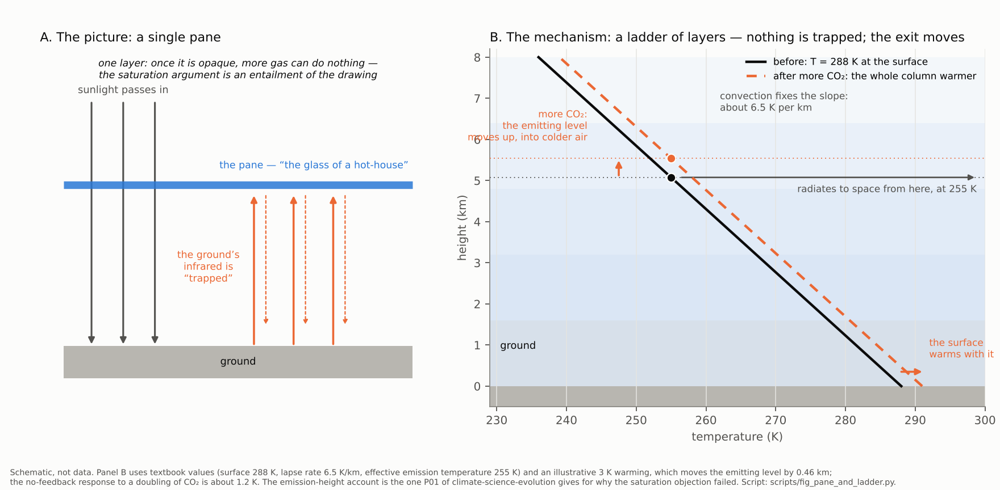

# Case study 04 — the "greenhouse": a foundational metaphor traced from the technical literature into public use

**Status:** v0.1, 2026-10-08. The trace is in `corpus.md` (T-1 … T-32); this file reads it as frames, then works five pairs (G1–G5) in both modes. The nineteenth-century primaries are quoted through translations, transcriptions and one historian's essay (classes `[W]`, `[S]`), the modern ones from fetches and three of Steve's captures; `sources/fetch-log.md` says which is which. A draft to be checked, not a source.

**Why this case.** The other cases are about words one side introduced and the other adopted. "Greenhouse" is a word the field chose for itself, between 1896 and 1908, for a mechanism it had already described in four other pictures; its own glossary calls it a misnomer; it is still the first sentence of the agency explainer; and the sceptical side's two most durable arguments against the mechanism — that the atmosphere is not a greenhouse (Wood 1909; Gerlich 2009) and that the effect is saturated (Ångström 1900; "declines as its concentration increases", 2015) — are both entailments of the picture rather than of the physics. A metaphor that both sides reason from is the best test of what a second look can do: name the picture, say what it hides, and offer a better one.

**Conventions** as in cases 01–03. Trace IDs (`T-n`) refer to `corpus.md`.

**Three findings that organize the case.** First, the lexicon: FrameNet puts *greenhouse* in `Buildings` ("a glass building in which plants that need protection from cold weather are grown"; the frame: "permanent fixed structures forming an enclosure and providing protection from the elements"), *trap* in `Trap` (a Deceiver, a Victim, a device to mislead and harm — there is no lexical unit for trap.v at all), *absorb* in `Soaking_up` (liquid into the interstices of an item) and *saturated* in `Being_wet` ("thoroughly soaked"). So the field's two commonest public verbs, "trap" and "absorb", are lexically a snare and a sponge, and the sceptical side's "saturated" is the sponge full. Second, the history: the building came late and from outside — Fourier's comparison was to a laboratory box, Tyndall's pictures were a gate, a blanket and a dam, the "hot-house" was Arrhenius's attribution to Fourier of a word Fourier never used, "green-house" is Ekholm's (1901, offered beside a second picture, the heat store), and "greenhouse effect" was born in Poynting's scare quotes (1907). Third, the cycle: the field has disowned the picture at least four times (Wood 1909; the AMS glossary; Weart; RealClimate 2007) and has not been able to put it down, because the pictures it offers instead — "trapped", "blanket" — carry the same hidden entailment, and the one that does not (the layers; the emission height) is not a picture a listener already has.

---

## The trace read as frames

| Form | First speaker | Source domain | What it presses | What it hides | Who uses it now |
|---|---|---|---|---|---|
| **Differential transparency** (T-1) | Fourier 1824 | Optics: two kinds of heat, one passing more easily than the other | Asymmetry: in easy, out hard | No agent, no enclosure — which is why it was never adopted | The textbooks' "shortwave in, longwave out" |
| **The gate** (T-2) | Tyndall 1859 | A door that admits and checks (`Preventing_or_letting`) | A gatekeeper's asymmetry | That exit is not stopped, only delayed; the gate has a setting | Rarely |
| **The blanket** (T-4) | Tyndall 1863 | `Clothing`; the body's warmth kept in | Comfort; necessity ("more necessary … than clothing is to man"); a beneficiary (vegetable life); the danger of frost | That a blanket has an outside colder than its inside — the one entailment the physics needs, which the glass does not have (G2) | NASA ("cozy blanket"); explainers everywhere |
| **The dam** (T-4) | Tyndall 1863 | A barrier across a stream that deepens the water behind it | That the flow is not stopped — Tyndall's continuation, from memory, has the dam "finally overflow" — only the level raised | The entailment that a higher dam means a deeper pool is right; the dam has no temperature | Almost no one; the best of the five |
| **The glass of a hot-house / green-house** (T-5, T-8, T-10) | Arrhenius 1896 (attributing it to Fourier); Ekholm 1901 | `Buildings`: an enclosure that protects plants from cold (`Protecting`) | Enclosure; a single pane; protection; a gardener's benefit | That real greenhouses work by stopping convection (Wood); that the pane is one layer (the saturation entailment); that there is no roof | The field's name; "so-called greenhouse gases" (GCC); "glass houses" (Gerlich) |
| **The heat store** (T-8) | Ekholm 1901 | `Store`: "a quantity or supply kept for use as needed" | A reservoir between warm ground and cold space; delay | The second picture Ekholm offered; dropped | The oceans' "heat content" literature, under another name |
| **The trap** (T-11, T-26) | The popular belief Wood tested, 1909; NASA | `Trap`: a snare with a Deceiver and a Victim | Capture; heat held, unable to leave (`Escaping`) | That nothing is held: the exit moves higher and colder; and that the lexicon's only trap is a deception | NASA ("heat is trapped"); "heat-trapping gases" in the press; the AMS glossary ("trapped radiatively") |
| **Artificial production** (T-12) | Callendar 1938 | `Artificiality` | The gas is made; the maker is us | — | "anthropogenic"; the UNFCCC's "both natural and anthropogenic" |
| **The greenhouse effect as an agent** (T-16) | Hansen 1988 | A thing that "has been detected" (`Becoming_aware`) and "is changing our climate" (`Cause_change`) | Presence; causation; detection as of a suspect | That what was detected was a warming consistent with a calculated response, not an effect seen | "fingerprint" (the next case) |
| **The degree zero** (T-17) | UNFCCC 1992 | None: "absorb and re-emit infrared radiation" | — | Nothing; it is also unmemorable | Lawyers |
| **Protection** (T-19) | GCC 1996 | `Protecting`: the Earth as Asset, "the freezing rigors of space" as Danger | The effect is natural and good; more of it is not implied to be bad | That protection has a dose | The sceptical side's concession formula |
| **The single sheet of glass** (T-20) | RealClimate 2007, naming the picture behind Ångström | `Containers`/`Substance`: one pane | The saturation argument's whole content | — | The mainstream's own account of where the saturation argument comes from |
| **The impossible machine** (T-21) | Gerlich & Tscheuschner 2009 | `Gizmo`: a heat pump forbidden by the second law | The mechanism as a device that would have to do work | That the atmosphere is not a pump and the physics is not a machine; answered once (Halpern et al. 2010) | The hard sceptical edge |
| **The thermostat / control knob** (T-22) | Lacis 2010 | `Controller_object`; `Control`; `Leadership` ("governs") | A setting; a hand on the knob; "turned sharply upward" | That a thermostat has a user who chose the setting; that the knob's range is bounded | NASA; Dessler's "unless CO2 is changing" (T-23) |
| **Food, bread, the stuff of life** (T-24, T-27) | Happer 2011; CO2 Coalition | `Food`; "daily bread" (a prayer) | Nourishment; more is better; a creature's need | That food has a dose; that the plants' food is also the air's absorber | The sceptical side's commonest frame |
| **Pollution** (T-30) | EPA (the Obama-era "carbon pollution") | *(gap)*: dirt, poison (`Toxic_substance`) | Harm; a culprit; something to clean up | That CO₂ is invisible, odourless, and the plants' food; that it harms by amount, not by nature | The mainstream policy register |
| **The small shift** (T-25, T-29) | Koonin 2014; van Wijngaarden & Happer 2020 | `Size`; `Change_position_on_a_scale` (*shift*: "change slightly in some way") | The human addition as a percentage of the natural whole | That 1–2 per cent of a very large number is the whole forcing of a doubling (G2) | The sophisticated sceptical form |
| **Hothouse, dominoes, cascade** (T-28) | Steffen et al. 2018 | Arrhenius's word; a row of dominoes; `System` ("a succession of devices or stages … each of which triggers the next") | Irreversibility; a chain with no stopping; machinery | That the dominoes are candidates with thresholds the paper itself calls uncertain; that "hothouse" was once the field's name for the ordinary effect | The mainstream's catastrophic register |

**What the table shows.** Two of Tyndall's pictures — the dam and the blanket — carry the entailment the physics needs (a barrier raises the level behind it without stopping the flow; a blanket's outside is colder than its inside), and the one the field chose instead, the glass, carries the two entailments the sceptical side has argued from for a century: that a greenhouse is not how the atmosphere works (true, and conceded) and that one opaque pane cannot be made more opaque (true of a pane, false of a column). The sceptical arguments are not outside the mainstream's picture; they are inside it.

---

## Pair G1 — Naming the mechanism: the glass and the trap vs. "misnomer", "so-called", "fictitious"

### The statements

M side:

> Fourier maintained that the atmosphere acts like the glass of a hot-house, because it lets through the light rays of the sun but retains the dark rays from the ground. (T-5, Arrhenius 1896)

> Firstly, the atmosphere may act like the glass of a green-house, […] Secondly, the atmosphere acts as a heat store placed between the relatively warm ground and the cold space, (T-8, Ekholm 1901)

> The greenhouse effect is the process through which heat is trapped near Earth's surface […] Imagine these gases as a cozy blanket enveloping our planet (T-26, NASA)

> something of a misnomer in this context. […] In the atmosphere, however, heat is trapped radiatively, while in an actual greenhouse, (T-31, AMS Glossary)

> This was the effect that would later be called, by an inaccurate analogy, the "greenhouse effect." (T-32, Weart)

> the loss of temperature of the ground by radiation is very small in comparison to the loss by convection […] I do not pretend to have gone very deeply into the matter (T-11, Wood 1909)

S side:

> GCC accepts the finding that there is a natural 'greenhouse effect' which protects the Earth from the freezing rigors of space. GCC agrees that the amount of so-called greenhouse gases in the Earth's atmosphere is increasing. (T-19, GCC 1996)

> fictitious mechanism, in which a planetary atmosphere acts as a heat pump […] According to the second law of thermodynamics such a planetary machine can never exist. […] there are no common physical laws between the warming phenomenon in glass houses […] the atmospheric greenhouse conjecture is falsified. (T-21, Gerlich & Tscheuschner 2009)

> In fact, the greenhouse effect is only about 25 percent of what it would be in a pure radiative situation. (T-18, Lindzen 1992)

### Mode A — FrameNet-literal annotation

| Side | Span | Target | FrameNet frame | Frame elements | Note |
|---|---|---|---|---|---|
| M | the GLASS of a HOT-HOUSE / GREEN-HOUSE | glass.n; greenhouse.n; hothouse | `Substance` / `Containers`; `Buildings`; **(gap)** | Building = the atmosphere | The frame definition of `Buildings`: "an enclosure and providing protection from the elements"; the LU: "a glass building in which plants that need protection from cold weather are grown". The name imports an enclosure, a roof, and a gardener. |
| M | LETS THROUGH the light rays … RETAINS the dark rays | let.v; retain.v | `Preventing_or_letting`; `Retaining` | Potential_hindrance = the atmosphere; Agent = the atmosphere; Theme = the dark rays | "Retains" is possession kept (`Retaining`: "continues to possess a Theme"): the rays are held. |
| M | a HEAT STORE placed between the relatively warm ground and the cold SPACE | store.n | `Store` | Supply = heat | Ekholm's second picture: a supply kept for use, between two temperatures — no enclosure. |
| M | heat is TRAPPED near Earth's surface … TRAPS extra heat | trap (v.) | **(gap)**; trap.n → `Trap` | Trap = the gases; Victim = heat | The lexicon has no trapping of heat; its only trap is "a device or strategy to mislead and cause harm", with a Deceiver and a Victim. |
| M | a COZY BLANKET ENVELOPING our planet | blanket.n; envelop.v | **(gap)** for the noun; `Distributed_position` | Theme = the gases; Location = the planet | The verb is coverage; the noun — a bed covering — is absent. "Cozy" **(gap)**. |
| M | something of a MISNOMER … heat is trapped RADIATIVELY … in an ACTUAL greenhouse | misnomer; actual | `Being_named`; (`Artificiality` by contrast) | Name = "greenhouse"; Entity = the effect | The glossary disowns the name and keeps the trap. |
| M | by an INACCURATE ANALOGY | inaccurate; analogy | (`Correctness`, negated); **(gap)** | — | The historian's verdict on the word. |
| M | the LOSS of temperature of the ground by RADIATION is very small in comparison to the loss by CONVECTION | loss; radiation; convection | (`Losing`?); `Emitting`; **(gap)** | — | Wood's measured sentence is about a box; his sentence about the atmosphere is "I do not pretend". |
| S | a natural 'GREENHOUSE EFFECT' which PROTECTS the Earth from the FREEZING RIGORS of SPACE | protect.v; freezing; rigor | `Protecting`; `Temperature` / `Ambient_temperature`; **(gap)** | Protection = the effect; Asset = the Earth; Danger = space's cold | The effect as shelter: a frame in which more of it is not obviously harmful. |
| S | the amount of SO-CALLED greenhouse gases | so-called | `Being_named` | Name = "greenhouse gases" | The name marked as a name (case 03, R2: the three "so-called"s). |
| S | FICTITIOUS mechanism … acts as a HEAT PUMP … such a planetary MACHINE can never EXIST … GLASS HOUSES … CONJECTURE … FALSIFIED | fictitious; pump; machine; exist.v; glass house; conjecture; falsify | **(gap)**; **(gap)**; `Gizmo`; `Existence`; (`Buildings`); **(gap)**; **(gap)** | Gizmo = the atmosphere as pump | The mechanism made a device, and the device made impossible; "glass houses" keeps the building. |
| S | the greenhouse effect is only about 25 PERCENT of what it would be in a PURE RADIATIVE situation | percent; pure | (`Proportional_quantity`?); (`Artificiality`: "pure") | — | Lindzen's number concedes the effect and discounts it by convection — the atmospheric version of Wood's point. |

**What Mode A gave for G1.** The name is a building (`Buildings`), the building is for protection (`Protecting`), and the verbs the field uses in public are a snare (`Trap`) and a covering (`Distributed_position`); the only lexical frames the sceptical side adds are `Being_named` (so-called, misnomer — which the mainstream glossary also uses of itself) and `Gizmo` (the machine). The two sides share the building: one lives in it, the other says it has no laws in common with the atmosphere, and the lexicon records that both are talking about a structure that protects plants from cold.

### Mode B — frames, metaphors, construal, scenario

**What the glass presses and hides.** THE ATMOSPHERE IS THE GLASS OF A GREENHOUSE maps a pane onto a column, a gardener's enclosure onto a planet, and plants onto us. Pressed: asymmetry (light in, heat kept), enclosure (nothing leaves), protection (the natural effect is good — the GCC's "protects the Earth from the freezing rigors of space" is the mainstream's picture, conceded). Hidden: (a) real greenhouses work by stopping convection (Wood 1909; the AMS: "mechanically prevented from escaping by the glass enclosure"), so the comparison is false of its own source; (b) a pane is one layer, and a column is many — the entailment that the saturation argument lives on (G2); (c) there is no roof: radiation does leave, from higher up and colder. Tyndall's dam had entailment (c) right — his continuation (from memory, to be checked) has the dam "finally overflow" — and his blanket had the temperature gradient right; the field chose the picture with neither.

**The disowning cycle.** The mainstream has said "it is not a greenhouse" in every register — Wood's experiment (1909), the glossary's "misnomer", the historian's "inaccurate analogy", RealClimate's "as if it were a single sheet of glass" — and in every case the sentence after the disowning restores a picture with the same hidden entailment: "trapped radiatively" (AMS), "heat is trapped" (NASA), "cozy blanket" (NASA). The lexicon's `Trap` is a snare set by a deceiver for a victim; its `Escaping` ("break free from confinement") is what radiation does in every explainer ("escape to space"). The field's public vocabulary is a jail: heat is held, heat escapes. What the physics says is that nothing is held: the exit moves.

**The sceptical uses of the concession.** The GCC puts the effect in scare quotes and the gases under "so-called" — case 03's `Being_named` move — while accepting both, and chooses the frame (`Protecting`) in which the effect is a shelter, so that "more" is not obviously "worse". Gerlich takes the disowned source domain as the target: "no common physical laws between the warming phenomenon in glass houses" and the atmosphere — true, conceded, and irrelevant to a mechanism that was described without the glass by Fourier, Tyndall and the UNFCCC — and makes the mechanism a `Gizmo` ("a heat pump", "a planetary machine") so that the second law can forbid it. The move is the mirror of Hansen's "the greenhouse effect has been detected": each side reifies the effect into a thing — an agent that is changing the climate, a machine that cannot exist — and argues about the thing. Lindzen's "only about 25 percent of what it would be in a pure radiative situation" is the honest version: the effect is real and convection reduces it, which is what Wood found for the box and Manabe & Strickler (1964) built into the model (`P01`).

**Construal.** "Heat is trapped" profiles the heat and backgrounds the exit; "absorb and re-emit" (UNFCCC) profiles the exit and has no picture; "a heat store placed between the relatively warm ground and the cold space" (Ekholm) profiles the two temperatures, which is the part the physics turns on. Of the three, the one the field kept is the one that hides the most.

### Substance notes (not framing)

That the atmosphere warms the surface, and which gases do it, was settled by 1861 (`P01`); that a real greenhouse works mostly by suppressing convection is Wood's 1909 result and the AMS glossary's account, and does not bear on the atmosphere, which Wood himself did not claim to have gone into; that convection reduces the pure radiative effect is the content of the radiative–convective model (Manabe & Strickler 1964; `P01`), not an objection to it. Gerlich & Tscheuschner 2009 is the one modern dispute of the mechanism in a physics journal; it was answered by Halpern et al. 2010 and generated no follow-up research (`P01`). The surface is about 33 °C warmer than an airless planet of the same reflectivity would be (AMS); the UNFCCC's definition — gases "that absorb and re-emit infrared radiation" — is the mechanism without a picture.

### Second looks

*If a friend says:* "It's not even a greenhouse — a physicist showed in 1909 that greenhouses don't work by trapping radiation. The whole thing is a misnomer."

> You're right, and so is the field's own glossary, which calls the name "something of a misnomer": a real greenhouse is warm mostly because the glass stops the warm air leaving. The name is a picture, chosen around 1900 by people who had already described the mechanism without it — Fourier's two kinds of heat, Tyndall's blanket and his dam. The physics doesn't need the building: certain gases absorb infrared and re-emit it, which is the treaty's whole definition. A better picture than the glass is Tyndall's dam — the flow still gets over, but the level behind it is higher. The question worth asking isn't whether the atmosphere is a greenhouse (it isn't) but whether more of those gases raises the level (that's the 1950s result, and the critics on your side — Lindzen, Happer — concede it).

*If I say (or a mainstream friend says):* "Greenhouse gases trap heat like a blanket."

> "Trap" and "blanket" each carry something the physics doesn't say: nothing is trapped — the atmosphere radiates to space from higher up, where it is colder — and that is why the other side's "it's not a greenhouse" and "it's already saturated" both land: they're arguments against the picture, and the picture is ours. The blanket is actually the better of the two, if you add the part that matters: a blanket's outside is colder than its inside, and a thicker one has a colder outside for the same warmth. Tyndall said "blanket" in 1863 and "dam" in the same lecture; either beats the glass.

---

## Pair G2 — Reasoning from the picture to the dose: "thicker blanket", "control knob" vs. "saturated", "a few per cent", "only 1% to 2%", "98 percent is water vapour"

### The statements

S side:

> (Ångström 1900, as Weart reports Koch's experiment:) Herr Koch reported that when he cut the amount of gas in the tube by one-third, […] the amount of radiation that got through scarcely changed. (T-7)

> The warming effect of each molecule of CO2 declines as its concentration increases (T-27, CO2 Coalition)

> Doubling the current concentrations of CO$_2$, N$_2$O or CH$_4$ increases the forcings by a few per cent. (T-29, van Wijngaarden & Happer 2020)

> human additions to carbon dioxide in the atmosphere by the middle of the 21st century are expected to directly shift the atmosphere's natural greenhouse effect by only 1% to 2%. Since the climate system is highly variable on its own, that smallness sets a very high bar for confidently projecting the consequences of human influences. (T-25, Koonin 2014)

> Even if all other greenhouse gases (such as carbon dioxide and methane) were to disappear, we would still be left with over 98 percent of the current greenhouse effect. (T-18, Lindzen 1992)

> CO2 really is a greenhouse gas […] Other things being equal, more CO2 will cause more warming. (T-24, Happer 2011)

M side:

> if the quantity of carbonic acid increases in geometric progression, the augmentation of the temperature will increase nearly in arithmetic progression (T-6, Arrhenius 1896)

> Like Ångström, they tended to treat the atmosphere overhead as a unit, as if it were a single sheet of glass. […] (Thus the "greenhouse" analogy.) […] it is the layers from which radiation does escape that determine the planet's heat balance. […] You'd still get an increase in greenhouse warming even if the atmosphere were saturated, […] It's not even true that the atmosphere is actually saturated with respect to absorption by CO2 (T-20, Weart & Pierrehumbert 2007)

> atmospheric CO2 operates as a thermostat to control the temperature of Earth. […] Within only the past century, the CO2 control knob has been turned sharply upward toward a much hotter global climate. […] water vapor accounts for about 50% of the Earth's greenhouse effect […] it is these non-condensing GHGs that actually control the strength of the terrestrial greenhouse effect (T-22, Lacis 2010)

> yes, water vapour is a more important greenhouse gas than CO2, but water vapour doesn't change systematically with time UNLESS CO2 is changing and initiating a warming (T-23, Dessler via Monbiot 2010)

> The planet's temperature is regulated by the thin upper layers where radiation does escape easily into space. (T-32, Weart)

### Mode A — FrameNet-literal annotation

| Side | Span | Target | FrameNet frame | Frame elements | Note |
|---|---|---|---|---|---|
| S | SATURATED / SATURATION of the absorption bands | saturated.a; saturate.v | `Being_wet`; `Cause_to_be_wet` | Item = the band / the atmosphere | FrameNet's only saturation is "thoroughly soaked". The argument's lay picture is a sponge that holds no more. |
| both | ABSORB / ABSORBERS / absorption | absorb.v | `Soaking_up` | Item = the atmosphere; Substance = radiation | "An Item becomes filled with a Substance as a result of movement of liquid into … interstices" — the sponge again, on both sides. |
| S | the warming effect of each MOLECULE … DECLINES as its concentration INCREASES | decline.v; increase | `Change_position_on_a_scale` | Item = the per-molecule effect | True (Arrhenius's law) and construed as diminishing returns. |
| S | increases the forcings by A FEW PER CENT | few; per cent | `Quantified_mass` / (`Proportional_quantity`) | — | The doubling as a fraction of the total. |
| S | SHIFT the atmosphere's natural greenhouse effect by ONLY 1% to 2% … that SMALLNESS sets a very high BAR | shift.v; only; small; bar | `Change_position_on_a_scale`; —; `Size`; (`Hindering`, image) | Item = the natural effect; Difference = 1–2% | The LU definition of shift.v is "change slightly in some way": the verb carries the smallness before the number does. |
| S | over 98 PERCENT of the current greenhouse effect | percent | (`Proportional_quantity`) | — | Share of the stock. |
| S | more CO2 will cause MORE WARMING | warming | `Change_of_temperature` | Item = (the climate) | The concession, in the dose frame's own terms. |
| M | increases in GEOMETRIC PROGRESSION … the augmentation of the temperature will increase nearly in ARITHMETIC PROGRESSION | progression | **(gap)** | — | The logarithmic law as Arrhenius wrote it; the sceptical "declines" is this sentence read from the other end. |
| M | as if it were a SINGLE SHEET of GLASS … the LAYERS from which radiation does ESCAPE | sheet; layer.n; escape.v | (`Shapes`?); `Part_ordered_segments`; `Escaping` | Theme = radiation; Undesirable_location = (the atmosphere) | The mainstream's correction keeps `Escaping` — confinement broken — for what is really emission from a height. |
| M | the THIN upper layers where radiation does ESCAPE easily | thin.a | `Measurable_attributes` | — | The layers' thinness, not the surface's opacity, is the quantity. |
| M | operates as a THERMOSTAT to CONTROL the temperature … the CO2 CONTROL KNOB has been TURNED sharply UPWARD … GOVERNS the temperature | thermostat; control.v; knob; turn.v; govern.v | **(gap)**; `Control`; `Controller_object`; `Cause_to_move_in_place`; `Leadership` | Controller_object = CO₂; Agent (of the turning) = unexpressed | A device with a setting; the hand on the knob is in the passive. |
| M | water vapour doesn't change SYSTEMATICALLY with time UNLESS CO2 is changing and INITIATING a warming | initiate.v | (`Activity_start` / `Cause_to_start`) | Cause = CO₂; Effect = the warming | Control of the change, against share of the stock. |

**What Mode A gave for G2.** The sponge. "Absorb" is `Soaking_up` and "saturated" is `Being_wet`, so the only lexical picture of absorption is liquid filling interstices, and the only lexical picture of saturation is the sponge full — which is the saturation argument in one word, and the picture a listener already has. Against it the mainstream's own words are `Part_ordered_segments` (layers), `Measurable_attributes` (thin) and `Escaping` — and `Escaping` concedes the jail. On the other axis, the lexicon records the two constructions of "how much": `Proportional_quantity`-type shares (98 per cent; a few per cent; 1–2 per cent) and `Control` (the knob, the thermostat, "initiating") — stock against control — and "shift" carries its smallness in its definition.

### Mode B — frames, metaphors, construal, scenario

**The saturation argument is the glass picture's entailment.** If the atmosphere is a pane, then an opaque pane cannot be made more opaque: once the band is black, more gas does nothing. That is Ångström's inference from Koch's tube, and it is exactly what the single-pane picture licenses — RealClimate's own account: "they tended to treat the atmosphere overhead as a unit, as if it were a single sheet of glass. (Thus the "greenhouse" analogy.)" The sponge (`Soaking_up`, `Being_wet`) is the same picture in the lexicon: a full sponge takes no more water. What the pane and the sponge both hide is that the column has a top, that the top is cold, and that the planet's emission to space in the band comes from the height at which the air becomes thin enough to let it out. Add CO₂ and that height rises into colder air; a colder emitter radiates less; the whole column must warm until the new emitting level is as warm as the old one was — and the surface, tied to it by convection, warms with it. Plass (1956) made this argument in the band wings and the upper troposphere (`P01`); Weart's sentence is its public form: "regulated by the thin upper layers where radiation does escape easily into space." Saturation at the surface is true of the band centre and irrelevant, because the surface is not where the planet radiates from. The sceptical side's oldest argument is a correct inference from the mainstream's chosen picture, and the mainstream's reply is to change the picture.

**The blanket, read carefully, is the right picture.** A blanket's outside is colder than its inside, and for the same heat flow a thicker blanket has a colder outer surface and a warmer inner one — which is the emission-height argument in domestic form. Tyndall's 1863 image carried the entailment the field needed; "greenhouse" displaced it; NASA's "cozy blanket" has it back without using it. The second look can use it: *a thicker blanket does not trap more; its outside gets colder.*

**Diminishing returns: the same law from two ends.** "The warming effect of each molecule of CO2 declines as its concentration increases" is Arrhenius's law of 1896 — "if the quantity of carbonic acid increases in geometric progression, the augmentation of the temperature will increase nearly in arithmetic progression" — stated by the man who used it to get 4° per doubling. Read from one end, the law says each molecule does less; from the other, that each *doubling* does the same. Which end a speaker reads from is a construal choice and not a fact, and the fact is that emissions have grown geometrically (`P02`), which is the end the law was written for.

**Percent of what.** "Only 1% to 2%" of the natural greenhouse effect, "a few per cent" of the forcings: the human addition construed as a fraction of a whole. The whole is about 155 W m⁻² (the difference between what the surface emits and what leaves the top; Kiehl & Trenberth 1997, `[K]`); 1–2 per cent of it is 1.5–3 W m⁻²; the forcing of a doubling is 3.7 W m⁻² (`P01`, `P06`). Koonin's "only 1% to 2%" and the assessments' "3.7 W m⁻²" are the same quantity, the first construed against the natural effect (large denominator), the second against the things it is compared with in practice — the aerosol forcing of about −1 W m⁻² (`P06`), a large eruption's year or two, the solar cycle's tenths. "Shift" (FrameNet: "change slightly") and "only" do the work before the number arrives; "potent" (`Chemical_potency`: "a large amount of a salient ingredient") does the opposite work in "a potent greenhouse gas". Neither side's adjective is in the physics; the ratio is.

**Share against control.** Lindzen's "over 98 percent of the current greenhouse effect" would remain with water vapour and clouds if CO₂ and methane vanished; Lacis's experiment removes the non-condensing gases and lets the water vapour respond, and the effect "would collapse" (NASA's word; `Endeavor_failure`). The two are different questions with different answers — share of the stock, control of the change — and each side's number is correct for its question. The mainstream's picture for its answer is a machine: THE CLIMATE IS A HEATING SYSTEM AND CO₂ IS ITS THERMOSTAT, with the knob "turned sharply upward" in a passive that has no hand. Pressed: a setting, a cause, a direction. Hidden: that a thermostat's user chose the setting on purpose, and that a knob has a stop. Dessler's newspaper version — "water vapour doesn't change systematically with time UNLESS CO2 is changing" — carries the same content without the device, and is the better sentence.

**Scenario / narrative.** S: the dose is small, the sponge is full, the big absorber is water — SMALL CAUSE, SMALL EFFECT, the folk physics of proportion. M: the knob, the layers, the thin cold top — the system picture, in which a small cause at the right place controls a large effect. The second look's job is to make the layers as available as the sponge.

### Substance notes (not framing)

The saturation objection failed on spectroscopy (band wings; the upper troposphere, where water vapour is scarce) and on method (the altitude of emission, not the transmission of a tube), and was accepted as failed within the specialist community by about 1960; after 1963 it does not appear in the meteorological literature and survives in non-specialist venues and one answered 2009 paper (`P01`). The logarithmic law is real and is why forcing is quoted per doubling; the forcing is 3.7 W m⁻² per doubling (Myhre et al. 1998; `P01`), confirmed from satellite spectra (Harries et al. 2001) and at the surface (Feldman et al. 2015). Water vapour's share of the present effect is about half, clouds a quarter, CO₂ a fifth (Lacis 2010, T-22, and the companion paper by Schmidt et al. 2010, `[K]`); its *feedback* — the reason it follows rather than leads — is `P05` (Raval & Ramanathan 1989; Held & Soden 2000). Koonin's 1–2 per cent is arithmetically consistent with the forcing to mid-century; his inference from its smallness to a "very high bar" is where the dispute is, and it is a dispute about sensitivity (`P04`), not about the radiation.

### Second looks

*If a friend says:* "CO₂'s absorption is already saturated — the first hundred parts per million did the work; more does almost nothing. And it's only a few per cent of the greenhouse effect anyway."

> "Saturated" is a sponge picture — a sponge that's full takes no more — and it's an honest reading of the glass-pane picture our side gave you: one opaque pane can't be made more opaque. The reason it fails isn't a trick; it's that the atmosphere isn't a pane, it's a stack, and the planet radiates to space from the top of the stack, where the air is thin and cold. More CO₂ moves that level higher and colder, and a colder emitter radiates less, so the whole stack warms until the books balance. That was worked out in the 1950s, and the critics on your side — Happer, Lindzen — concede that more CO₂ means more warming. "A few per cent" is true too, and it's the same number as the forcing of a doubling; whether 3–4 watts per square metre is small is a question about what it's compared to.

*If I say (or a mainstream friend says):* "CO₂ is the control knob — more of it traps more heat, like a thicker blanket."

> Two of those pictures work and one doesn't. "Trap" invites "it's already saturated", and the honest answer to that is that nothing is trapped — the exit just moves higher and colder. The blanket works if you say the part that matters: a thicker blanket's outside gets colder, which is why it warms the inside. The knob is a physicist's result — take the non-condensing gases out and the water vapour follows them down — but it has a hand on it that the passive voice hides. And the other side's number, "a few per cent", is our 3.7 watts; the argument is about whether that is small, which is an argument about sensitivity, not about the radiation.

---

## Pair G3 — Characterizing the substance: "carbon pollution" vs. "plant food", "daily bread", "the stuff of life"

### The statements

M side:

> Carbon Pollution from Transportation […] Learn about the effects of carbon pollution from transportation. […] Burning fossil fuels like gasoline and diesel releases carbon dioxide, a greenhouse gas, into the atmosphere. (T-30, EPA 2026)

> those gaseous constituents of the atmosphere, both natural and anthropogenic, that absorb and re-emit infrared radiation. (T-17, UNFCCC 1992)

> The artificial production of carbon dioxide and its influence on temperature (T-12, Callendar 1938, title)

S side:

> Carbon is the stuff of life. […] As far as green plants are concerned, CO2 is not a pollutant, but part of their daily bread […] the concentration is about 390 ppm, 0.039 percent of all atmospheric molecules (T-24, Happer 2011)

> The most important role of CO2 is that of a plant food that makes life on Earth possible. […] By any scientific measure, CO2 is not a pollutant. […] First and foremost, CO2 is plant food. […] Current CO2 levels are near record lows. We are CO2 impoverished. […] For human advancement, warmer is better than colder. (T-27, CO2 Coalition)

> We may find a kind of consolation in the consideration that here […] there is good mixed with the evil. […] we may hope to enjoy ages with more equable and better climates (T-10, Arrhenius 1908)

### Mode A — FrameNet-literal annotation

| Side | Span | Target | FrameNet frame | Frame elements | Note |
|---|---|---|---|---|---|
| M | carbon POLLUTION | pollution | **(gap)** (pollute.v, pollutant, dirty, clean all absent) | — | The whole dirt/cleanliness vocabulary is outside the lexicon; the nearest frame is `Toxic_substance` (poison: "a substance that causes death or harm when introduced into … a living organism"). |
| M | CARBON | carbon | **(gap)** | — | The metonym — the element for the gas — has no entry; "carbon" is what coal, diamonds and we are made of, which is the sceptical side's point. |
| M | ARTIFICIAL production … both NATURAL and ANTHROPOGENIC | artificial; natural; anthropogenic | `Artificiality`; **(gap)**; **(gap)** | — | Case 01's finding again: the made/genuine partition, with "natural" itself absent from the lexicon. |
| M | ABSORB and RE-EMIT infrared radiation | absorb; emit | `Soaking_up`; `Emitting` | Item = the constituents | The degree zero: no evaluation, no size. |
| S | the STUFF of LIFE … plant FOOD … their daily BREAD … makes LIFE on Earth POSSIBLE | stuff; life; food; bread; possible | **(gap)**; `Biological_entity` / `Dead_or_alive`; `Food`; `Food`; `Possibility` | — | `Food`: "any nutritious substance that … plants absorb in order to maintain life and growth" — the lexicon's own definition grants the frame's premise. "Daily bread" is the Lord's Prayer. |
| S | NOT a POLLUTANT | pollutant | **(gap)** | — | The denial of a frame the lexicon does not hold either. |
| S | 0.039 PERCENT of all atmospheric molecules … a TRACE | percent; trace.n | (`Proportional_quantity`); `Quantified_mass` ("a very small amount") | — | The field's own "trace gases" (T-14), turned. |
| S | We are CO2 IMPOVERISHED … near record LOWS | impoverished; low | `Wealthiness` ("very poor"); `Position_on_a_scale` | — | Poverty: a shortage of a good. |
| S | warmer is BETTER than colder … more equable and BETTER climates … GOOD mixed with the EVIL … CONSOLATION | better; good; evil; consolation | `Desirability`; `Desirability`; **(gap)**; **(gap)** | — | The benefit frame, 1908 and 2015, in the same word. |

**What Mode A gave for G3.** The lexicon holds `Food` and `Toxic_substance` and nothing in between — no pollution, no pollutant, no carbon, no natural — so the two sides' names for the gas are, lexically, nourishment and poison, and the field's technical name for it (a constituent that absorbs and re-emits) is in neither. `Food`'s own definition — "any nutritious substance that … plants absorb in order to maintain life and growth" — grants the sceptical frame's premise, and `Quantified_mass`'s "trace" ("a very small amount") grants the other. What neither frame has is a dose: food and poison are kinds in the lexicon, and in pharmacology they are amounts.

### Mode B — frames, metaphors, construal, scenario

**Two frames for one molecule.** CO₂ IS POLLUTION: dirt, soot, the smokestack, a culprit, a clean-up. Pressed: harm; responsibility; removability. Hidden: that the gas is invisible, odourless, natural, exhaled, and the plants' food; that it harms by amount and by rate, not by nature — which is why "pollution" invites the reply "by any scientific measure, CO2 is not a pollutant", a sentence that is true of the frame and silent about the amount. CO₂ IS PLANT FOOD (bread; the stuff of life): nourishment, growth, necessity, a creature's need. Pressed: benefit; naturalness; the absurdity of regulating food. Hidden: that food has a dose; that the food's other property — absorbing infrared — is the one at issue, and both are true of the same molecule at once; that plants also need water, nutrients and a temperature range, so that "more food" is not "more growth" everywhere. The two frames are complementary selections from one substance: the field's "trace gases" (T-14) became the sceptical "only a trace", and the sceptical "plant food" has the greening of the Earth (Zhu et al. 2016, `[K]`) as its true core, as "pollution" has the forcing as its.

**The ancestor of the benefit frame.** "For human advancement, warmer is better than colder" (2015) is Arrhenius (1908): "we may hope to enjoy ages with more equable and better climates", with "good mixed with the evil" and "a kind of consolation". The sceptical side's benefit frame is the founder's; the mainstream's departure from it is a finding about rates and distributions (`P10`, `P11`, `P12`), not a change of picture. A second look can say so: the question is not whether warmth can be good — Arrhenius thought so — but how fast, how much, and for whom.

**Poverty.** "We are CO2 impoverished" (`Wealthiness`: "very poor") and "near record lows" construe the present concentration against the geological past (hundreds of millions of years, when there were no ice caps and no people) rather than against the past of agriculture and cities (the last ten thousand years, at 260–280 ppm); the denominator chooses the verdict, as it did in G2.

**The metonym.** "Carbon" for carbon dioxide (`[gap]`) is the mainstream's compression — carbon tax, carbon footprint, carbon pollution — and it is where the sceptical reply "carbon is the stuff of life" gets its purchase: the element is what we are made of, the gas is what we exhale, and the policy word names the first. Nerlich and Koteyko's "carbon compounds" literature traces the family (see the literature pass); for this case the point is that each side's compound names a true property and claims it is the one that matters.

**Scenario / narrative.** M: the polluter and the clean-up — villain (the smokestack), victim (the air, the public), remedy (regulation). S: the gardener and the regulator — hero (the plant, the farmer), villain (the agency that would ration food), remedy (leave it alone). Neither cast has a place for a dose–response curve, which is where the substance lives.

### Substance notes (not framing)

CO₂ fertilization is real and the greening is observed (Zhu et al. 2016, `[K]`, to be verified); it is bounded by water, nutrients and heat, and the assessments' crop projections net it against those (`P11`). The gas is a "trace" constituent by mass and the dominant non-condensing absorber by effect (`P06`: "the 'CO₂ problem' became the 'greenhouse-gas problem'" when the other trace gases were found to add as much again); CFCs at parts per trillion are "thousands of times more effective" per molecule (`P06`), which is the counter-example to "small amount, small effect". Whether CO₂ is a "pollutant" is a legal question (in the United States it was answered in the affirmative in 2007 under a statute's definition, `[K]`), not a physical one. The pre-industrial concentration was about 280 ppm; the present is above 420; the "record lows" are of the last few million years, which are also the years of the ice ages and of humans (`P02`, `P09`).

### Second looks

*If a friend says:* "CO₂ isn't pollution — it's plant food. The Earth is greening. We're at historically low levels."

> All three are true at the level they're said. Plants do grow more with more CO₂ and the satellites do see greening; "historically low" is true against the deep past, before ice caps and before people, and false against the ten thousand years in which farming and cities happened, at about 280 parts per million. "Pollution" was our side's word, and it does carry a picture of dirt the gas doesn't fit — it's invisible, natural, and what we exhale. But "food" hides the same thing "pollution" hides: the dose. The same molecule that feeds the plant absorbs infrared, and the question is never whether CO₂ is good or bad in kind but what the amount and the rate do — Arrhenius, who first did the sums, hoped for "better climates" too.

*If I say (or a mainstream friend says):* "It's carbon pollution."

> "Pollution" says dirt and a culprit, and the other side has an easy reply: it's invisible, it's natural, it's what plants eat. "Carbon" is also a compression — the element is the stuff of life; the gas is what absorbs infrared — and the reply "carbon is the stuff of life" is aimed at exactly that gap. The ground that doesn't invite the reply is the amount and the rate: 280 to over 420 parts per million in two centuries, with the absorption that implies. Say that, and "plant food" becomes something to agree with rather than argue about.

---

## Pair G4 — Naming the extreme: "Hothouse Earth", dominoes, "a threat of disaster" vs. "fictitious", "a planetary machine [that] can never exist", "hysteria"

### The statements

M side:

> there is a risk of Earth entering what the scientists call "Hothouse Earth" conditions […] A "Hothouse Earth" climate will in the long term stabilize at a global average of 4-5°C higher than pre-industrial […] These tipping elements can potentially act like a row of dominoes. […] This cascade of events may tip the entire Earth system into a new mode of operation. […] tipping elements in the planetary machinery (T-28, Steffen et al. 2018 via SRC)

> West Antarctic ice sheet and CO₂ greenhouse effect: a threat of disaster (T-15, Mercer 1978, title)

> In my opinion, that the greenhouse effect has been detected, and it is changing our climate now. (T-16, Hansen 1988)

> If carbon dioxide were removed, the terrestrial greenhouse effect would collapse (T-26, NASA)

S side:

> fictitious mechanism, in which a planetary atmosphere acts as a heat pump […] such a planetary machine can never exist. […] the atmospheric greenhouse conjecture is falsified. (T-21, Gerlich & Tscheuschner 2009)

> the cooling hysteria had certain striking analogues to the present warming hysteria (T-18, Lindzen 1992)

### Mode A — FrameNet-literal annotation

| Side | Span | Target | FrameNet frame | Frame elements | Note |
|---|---|---|---|---|---|
| M | "HOTHOUSE Earth" conditions | hothouse | **(gap)** | — | Arrhenius's word for the ordinary effect (T-10, "the hot-house theory"), reborn as the name of its extreme. |
| M | a ROW of DOMINOES … this CASCADE of events may TIP the entire Earth system … TIPPING elements … THRESHOLD | domino; cascade.n; tip.v; tipping; threshold | **(gap)**; `System` ("a succession of devices or stages … each of which triggers or initiates the next") / `Natural_features` (a waterfall); **(gap)**; **(gap)**; **(gap)** | — | The lexicon has the cascade as a device chain and as a waterfall; tipping and thresholds are gaps. |
| M | the planetary MACHINERY … a new MODE of OPERATION | machinery; mode; operation | **(gap)** (machine.n → `Gizmo`); —; — | — | The Earth as a machine with modes — on this side as on the other (Gerlich's "planetary machine"). |
| M | a THREAT of DISASTER | threat; disaster | (`Risky_situation` / `Endangering`); (`Catastrophe`) | — | The greenhouse joined to catastrophe in a journal title. |
| M | the greenhouse effect has been DETECTED, and it is CHANGING our climate NOW | detect.v; change.v | `Becoming_aware`; `Cause_change` | Cognizer = (we); Phenomenon = the effect; Agent = the effect; Entity = our climate | The effect as a presence found and an agent acting. |
| M | would COLLAPSE | collapse.v | `Endeavor_failure` ("fall apart metaphorically so as to be unable to continue operation") | Endeavor = the effect | The only sense: an enterprise failing. |
| S | FICTITIOUS mechanism … a planetary MACHINE can never EXIST … CONJECTURE … FALSIFIED | fictitious; machine; exist; conjecture; falsify | **(gap)**; `Gizmo`; `Existence`; **(gap)**; **(gap)** | — | The extreme on this side is non-existence. |
| S | the cooling HYSTERIA … the present warming HYSTERIA | hysteria | **(gap)** | — | A clinical word for a crowd; the fashion-cycle frame (G5). |

**What Mode A gave for G4.** Both extremes are gaps: "hothouse", "tipping", "threshold", "domino" on one side and "fictitious", "hysteria", "conjecture" on the other are all outside the lexicon, while the one shared word, *machine* (`Gizmo`), is used by both — "the planetary machinery" that can "tip" into "a new mode of operation" and "a planetary machine [that] can never exist". And "collapse" has only `Endeavor_failure`: the natural effect's removal is, lexically, a failed enterprise.

### Mode B — frames, metaphors, construal, scenario

**Hothouse, twice.** Arrhenius's "hot-house theory" (1908) was the name of the ordinary mechanism and of a hoped-for "better" climate; "Hothouse Earth" (2018) is the name of a 4–5 °C world with "uninhabitable" places. The word's career is the field's: the building that protected plants became the building that cooks them. Pressed by the 2018 use: a state, not a trend; a threshold with no return; a chain (dominoes) in which each fall causes the next. Hidden: that the paper's tipping elements are candidates whose thresholds it calls uncertain, and that the domino picture entails a mechanical inevitability the paper's own hedges ("potentially", "may") withdraw. The mainstream's extreme and the sceptical side's reading of it as "hysteria" are each other's evidence.

**The machine, twice.** Steffen's "planetary machinery" with "modes of operation" and Gerlich's "planetary machine [that] can never exist" are one frame (`Gizmo`) with opposite verdicts: the mainstream's catastrophe is a machine switching modes; the sceptical side's refutation is a machine that violates the second law. The physics is neither — a column that radiates from a height and a set of feedbacks with time constants — and both machines leave the ladder: the cascade for a world above the top rung, the impossible pump for a world with no rungs.

**Detection and collapse.** Hansen's "the greenhouse effect has been detected, and it is changing our climate now" makes the effect a presence (`Becoming_aware`) and an agent (`Cause_change`), which is the reification the sceptical side then argues against as a thing (a "conjecture", "falsified"); NASA's "would collapse" (`Endeavor_failure`) makes the natural effect an enterprise that could fail. Each is the extreme of the agent picture that "trap" began: once the effect is a thing that acts, it can be caught, it can fail, and it can be denied existence.

**Scenario / narrative.** M: the threshold story — a row of dominoes, a point of no return, a planet that "tips"; cast: the emitters (villain), the system (victim), the scientists who see the threshold (heroes), the remedy "not only reduction" but stewardship. S: the fiction story — a machine that cannot exist, a crowd in hysteria, a theory that will go the way of the cooling scare; cast: the physicists (heroes), the public (victim of the fiction), the remedy "falsified". Both are stories about the mechanism's existence at the limit; neither is a story about its amount.

### Substance notes (not framing)

Tipping elements are a defined concept with nine original candidates (Lenton et al. 2008), whose early adopters were the planetary-boundaries and early-warning literatures rather than the modelling community (`P12`, `05-citation-traces`); the marine ice-sheet instability that Mercer's 1978 title named is a real mechanism whose timing is open (`P12`). "Hothouse Earth" (Steffen et al. 2018) is a scenario paper with explicit uncertainties, not a projection; its "4–5 °C" is a long-term equilibrium under a cascade the paper calls possible. On the other side, Gerlich & Tscheuschner's claim that the mechanism violates the second law was answered by Halpern et al. 2010 and is not held by the sceptical physicists quoted elsewhere in this case (Lindzen: "the greenhouse effect is only about 25 percent of what it would be in a pure radiative situation"; Happer: "CO2 really is a greenhouse gas"). The 1970s "cooling" was a minority of papers and a majority of magazine covers (Peterson, Connolley & Fleck 2008, `[K]`).

### Second looks

*If a friend says:* "The greenhouse effect is a fiction — a heat pump that violates the second law. And the 'hothouse' stuff is the same hysteria as the 1970s ice age."

> Two different claims. The first is one 2009 paper's, answered in the same journal, and it isn't held by the physicists on your side: Lindzen and Happer both say the effect is real and argue about the size. "Heat pump" is a machine picture, and the atmosphere isn't a machine — it radiates to space from a cold height, no work required. The second claim is about a word: "hothouse" was Arrhenius's own name for the ordinary effect, and its 2018 use for a 4–5 °C world is a scenario with its hedges in the paper — "potentially", "may". The 1970s cooling was a few papers and many magazine covers. "Hysteria" and "dominoes" are each other's evidence; the ladder — how much, how fast — is where neither word helps.

*If I say (or a mainstream friend says):* "We're heading for Hothouse Earth — the tipping points fall like dominoes."

> "Dominoes" says each fall causes the next and nothing stops the row, and the paper that coined "Hothouse Earth" doesn't say that — it says "potentially", "may", and calls the thresholds uncertain. "Hothouse" was also the field's own word for the ordinary effect in 1908, which the other side will enjoy pointing out. The ground that holds is the ladder: the forcing, the sensitivity range, the ice sheets' own timescales — each with a number and an uncertainty. "Tipping" is a real concept with a short list of candidates; "dominoes" is the picture that turns a list into a prophecy.

---

## Pair G5 — Using the history: "addressed by physicists 50 years ago" vs. "the cooling hysteria", "Arrhenius welcomed it"

### The statements

M side:

> These issues were satisfactorily addressed by physicists 50 years ago, (T-20, Weart & Pierrehumbert 2007)

> This was the effect that would later be called, by an inaccurate analogy, the "greenhouse effect." (T-32, Weart)

S side:

> the cooling hysteria had certain striking analogues to the present warming hysteria (T-18, Lindzen 1992)

> we may hope to enjoy ages with more equable and better climates (T-10, Arrhenius 1908 — as the sceptical side cites him)

### Mode B, briefly

Both sides use the same names — Fourier, Tyndall, Arrhenius — and the same two centuries, for opposite jobs. The mainstream's history is a LINEAGE: a line of physicists from 1824 to 1967, each adding, so that the present position is old and the objections are older ("addressed … 50 years ago"); its hidden entailment is that age is evidence, which it is not — Ångström's objection was also old, and held the field for fifty years. The sceptical side's history is a FASHION CYCLE: cooling scare, warming scare, each a "hysteria" (a clinical word for a crowd), so that the present position is a mood that will pass; its hidden entailment is that the 1970s cooling was a scientific consensus, which the literature count does not support (`[K]`, Peterson et al. 2008), and that a reversal once makes a reversal likely — the gambler's reading of history. "Arrhenius welcomed warming" is the sceptical side's best historical sentence and is true (T-10); what it hides is that Arrhenius's "better climates" were for Sweden, at 4° per doubling over millennia of coal-burning at 1904 rates, and that the same book says the combustion of coal "suffices to increase the percentage of carbon dioxide in the air to a perceptible degree" — the detection claim the sceptical side disputes, in the founder's voice. Each side reads the founder from its own end, as G2 read his law.

*Second look, either direction:* "The history settles nothing either way — the objection that held the field for fifty years was old too, and the founder who hoped for better climates also said the coal was already changing the air. What the history gives is the sequence: pictures first (gate, blanket, dam, glass), the physics without pictures later (the layers, 1956–67), and the pictures still in use. Which picture is being argued from?"

---

## Figure G-1 — the pane and the ladder

*Figure G-1. **A.** The picture: the atmosphere as a single pane. Sunlight passes in; the ground's infrared is held back; the pane is one layer, so once it is opaque more gas can do nothing — the saturation argument is an entailment of the drawing. **B.** The mechanism: the atmosphere as a ladder of layers whose temperature falls with height. In the CO₂ band the planet radiates to space from the height at which the air is thin enough to let it out — about 255 K, several kilometres up — not from the ground. Adding CO₂ raises that height into colder air; a colder emitter radiates less; the column warms (the dashed profile) until the new emitting level is as warm as the old one was, and the surface, tied to it by convection along the lapse rate, warms with it. Nothing is trapped; the exit moves. The shift is exaggerated for the drawing (a 3 °C surface warming moves the level by about half a kilometre). Built by `scripts/fig_pane_and_ladder.py`; schematic, not data.*

What the figure does for the case: it is the second look's picture — the one a listener does not already have — and it shows, in one drawing, why Wood's objection (G1), the saturation objection (G2) and the "trap" and "blanket" vocabulary (G1) all answer to the same correction.

---

## What the case adds to the method

1. **Trace the metaphor before analysing the argument.** Both durable sceptical objections to the mechanism are entailments of the field's own picture: Wood's (a greenhouse does not work by trapping radiation — true) and Ångström's (an opaque pane cannot be made more opaque — true of a pane). A second look that knows the trace can grant both and move the picture.
2. **The lexicon's picture of absorption is a sponge** (`Soaking_up`, `Being_wet`), and the sponge is the saturation argument. The protocol's Step 1 scan should flag *absorb*/*saturated* the way it flags *significant*: a lay frame doing technical work.
3. **The better picture was already there.** Tyndall's blanket (with its colder outside) and his dam (which "finally overflows") carry the entailment the physics needs; the glass does not. Name the earlier picture rather than inventing one.
4. **Percent of what.** "Only 1–2%", "a few per cent", "98 percent", "0.039 percent", "record lows" are all true at a chosen denominator; the second look states the denominator. Add to the Step 2 checklist with the naming scale and the grain question.
5. **Share against control.** Two questions wearing one word ("how much of the greenhouse effect is CO₂?") have two correct answers; the second look separates them before the numbers are compared.
6. **Food and poison are kinds; the dispute is an amount.** Where each side's name for a substance is a kind (`Food`, `Toxic_substance`), the second look asks for the dose–response, which neither frame contains.
7. **The reified effect.** "The greenhouse effect has been detected" (an agent), "would collapse" (an enterprise), "a planetary machine [that] can never exist" (a device): once the effect is a thing, it can be caught, fail, or be denied existence. The treaty's sentence — gases "that absorb and re-emit infrared radiation" — is the de-reified form and the one to return to.
8. **The founder from both ends.** Arrhenius's law ("geometric … arithmetic") and Arrhenius's hope ("better climates") are each read from the end that suits; a second look can quote the other end.

## Open questions for Steve

- The nineteenth-century sentences are quoted through translations and transcriptions (`[W]`, `[S]`): Fourier through the 1837 translation as the PALE essay quotes it; Tyndall's blanket through a blogger's transcription of the 1865 edition and his dam through RealClimate; Ekholm through two secondaries. If you can reach the originals (Tyndall's *Heat considered as a Mode of Motion* is on archive.org, which is closed to the tools here; Ekholm is behind Wiley), the trace table's first eight rows become `[U]`.
- The total greenhouse effect of about 155 W m⁻² (Kiehl & Trenberth 1997), Schmidt et al. 2010's attribution of it, Zhu et al. 2016's greening, and Peterson et al. 2008's count of the 1970s cooling literature are `[K]` and carry weight in G2–G5; each should be checked before the case is relied on.
- Whether to add a sixth pair on "the atmospheric window" and "radiative forcing" — two technical terms (`Connecting_architecture`; the gap *forcing*) that have not crossed into public use, as a control for the trace: what a metaphor looks like when it stays inside the field.
- Figure G-1 is a schematic. If you want it quantitative — an actual emission-height calculation with a real lapse rate and the 255 K effective temperature — the script can be extended, at the cost of the drawing's simplicity.
